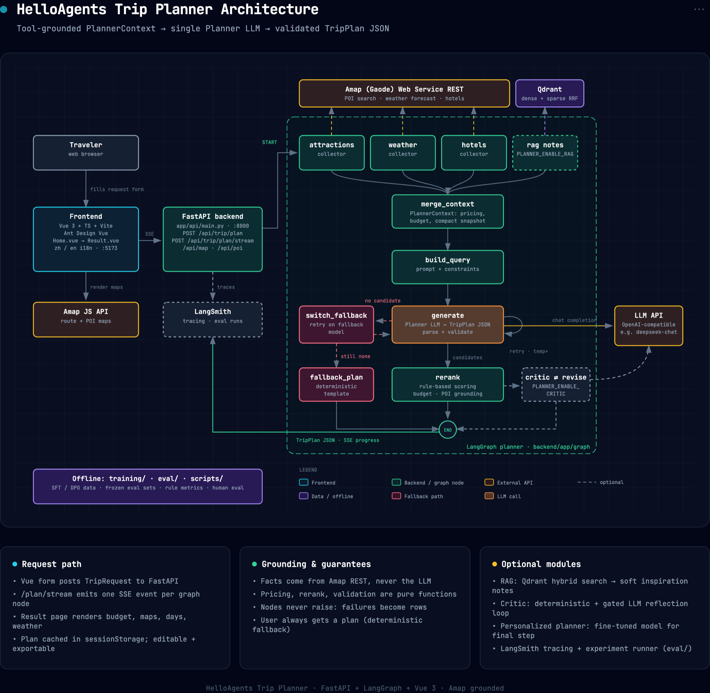
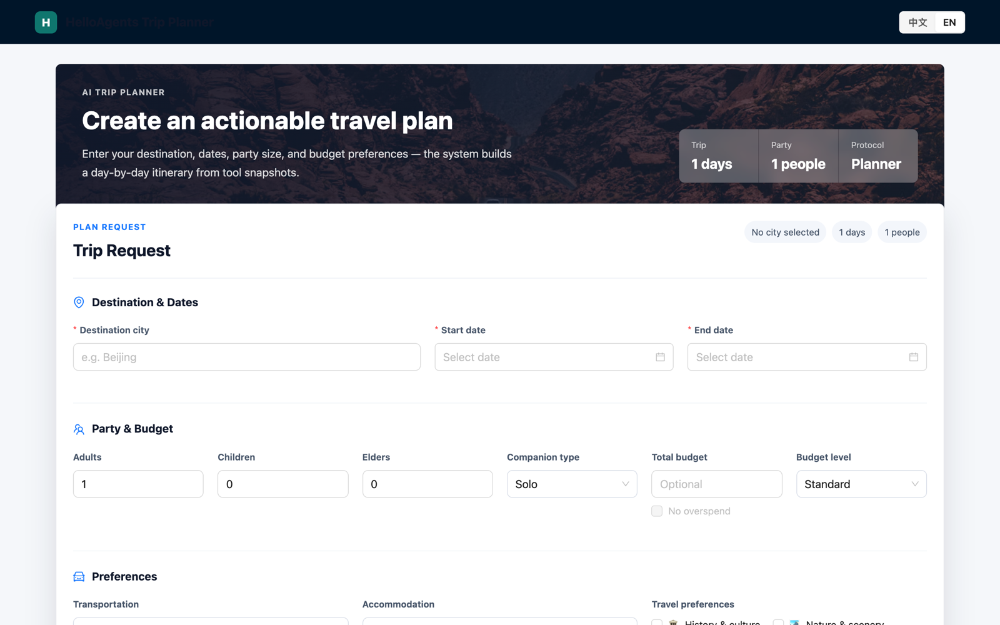
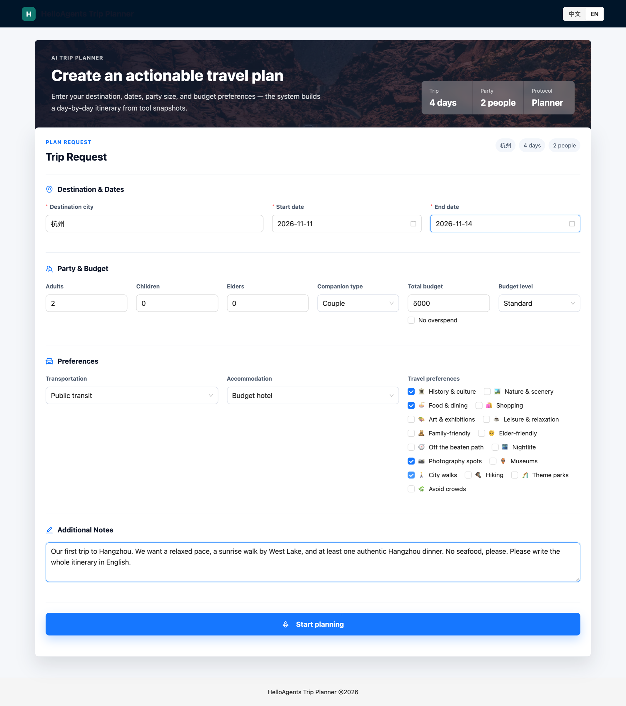
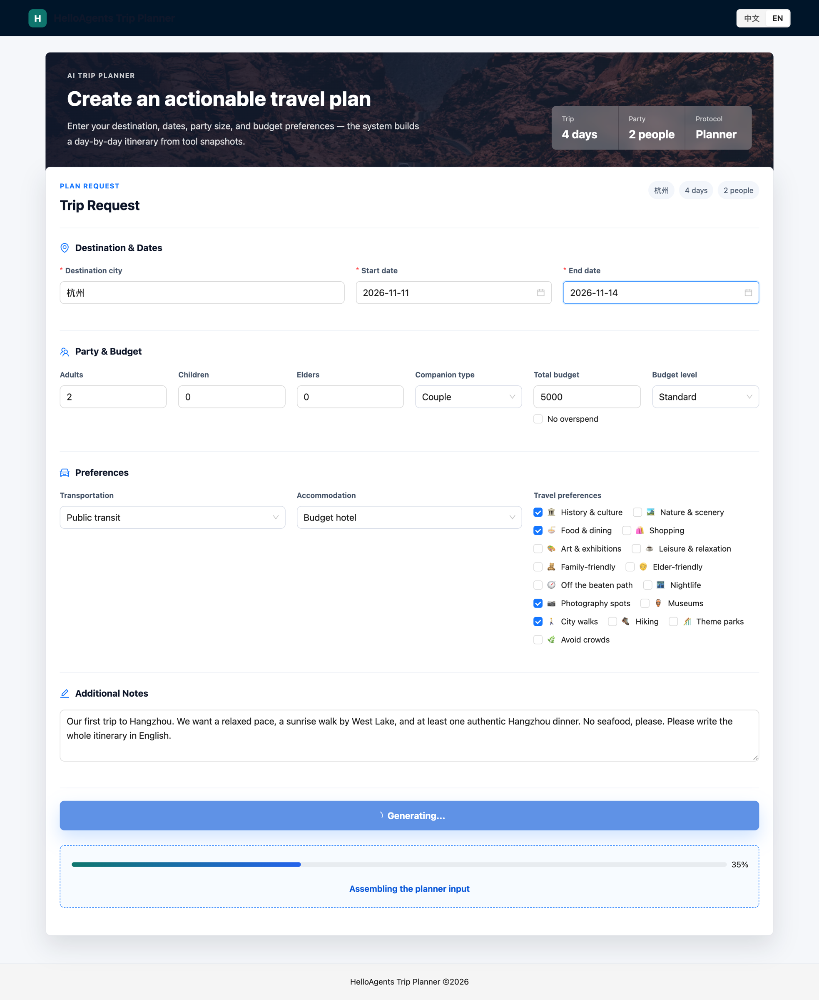
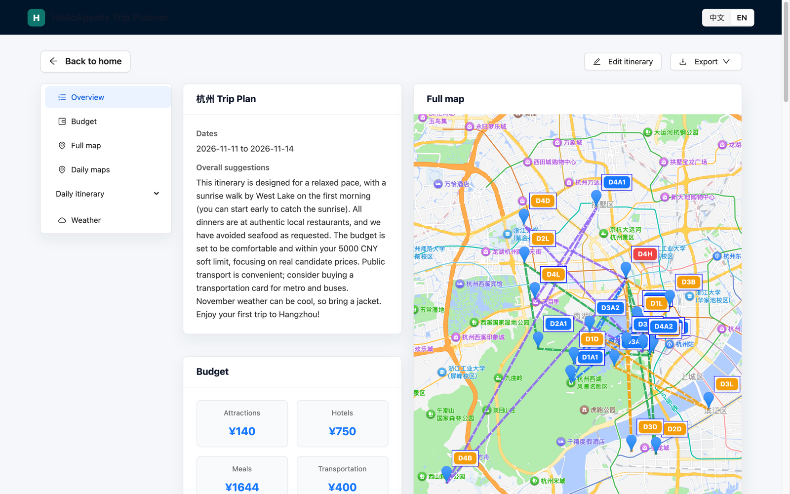
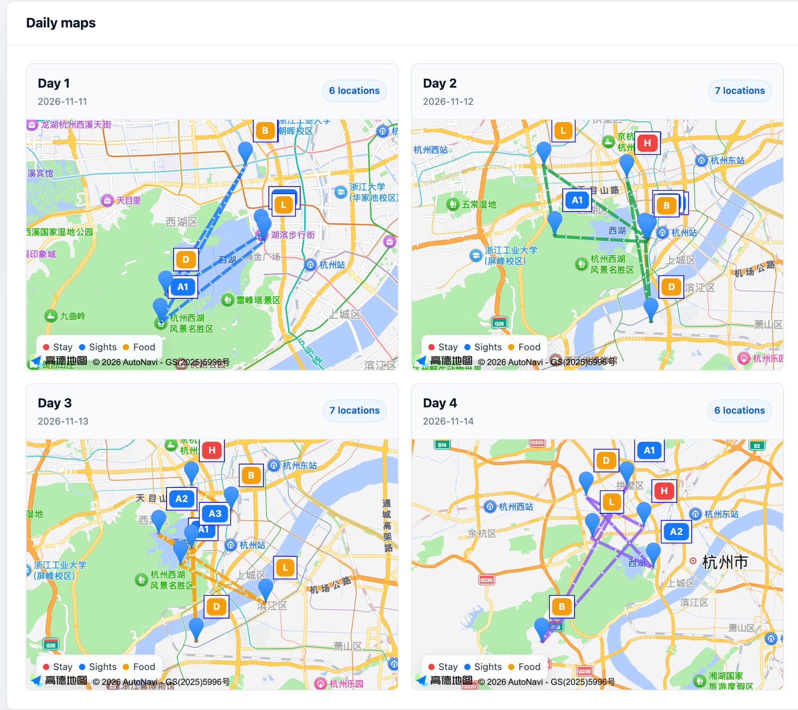
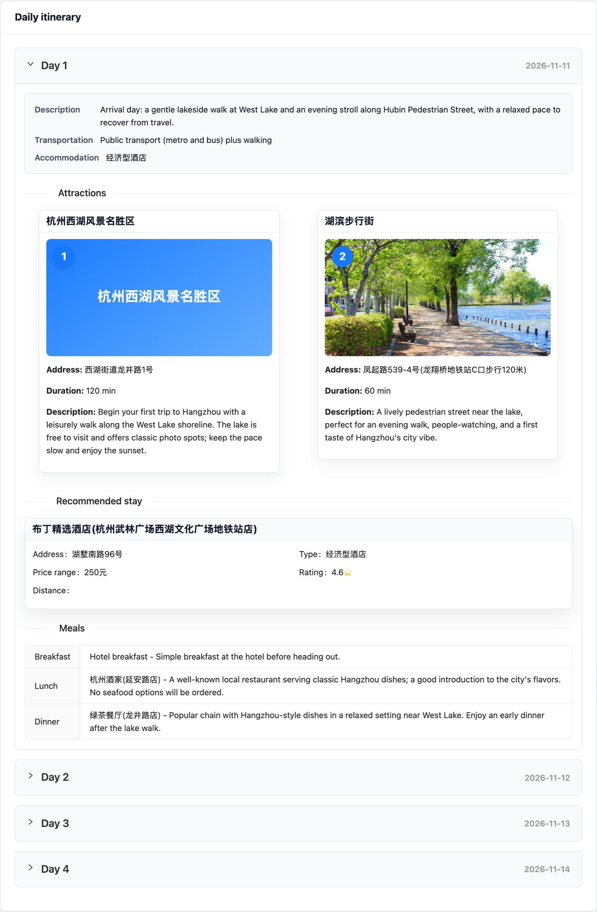
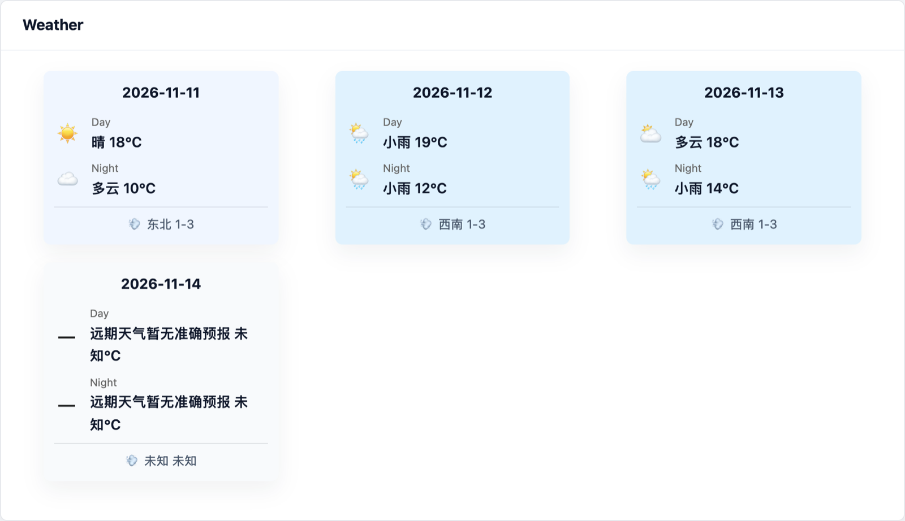

<div align="center">

# HelloAgents Trip Planner

[English](README.md) | **日本語**

短いリクエストから、予算・地図・ホテル・食事・天気を含む日ごとの旅程を生成する AI 旅行プランナーです。すべての情報は実際の地図データに基づいています。

</div>

---

## 目次

- [このプロジェクトについて](#このプロジェクトについて)
- [アーキテクチャ](#アーキテクチャ)
- [ユースケース：カップルが 4 日間の杭州旅行を計画する](#ユースケースカップルが-4-日間の杭州旅行を計画する)
- [起動方法](#起動方法)
- [トラブルシューティング](#トラブルシューティング)
- [ディレクトリ構成](#ディレクトリ構成)
- [ライセンス](#ライセンス)

## このプロジェクトについて

多くの LLM 旅行プランナーは、観光地・営業時間・料金・ホテルといった事実情報までモデルに作らせています。本プロジェクトでは、事実情報をモデルに任せません。

- **事実はツールから取得します。** 観光地・ホテル・レストラン・天気は Amap（高徳地図）REST API から取得し、チケット・ホテル・食事の料金は決定論的な価格ルールで算出します。
- **モデルは計画だけを担当します。** バックエンドがすべての情報を監査可能な `PlannerContext` にまとめ、単一の Planner LLM がそれを構造化された `TripPlan` JSON に組み立てます。
- **出力は検証されます。** 候補プランはすべてパース・検証され、予算適合度・POI の実在性・重複をルールで採点されます。LLM が失敗しても、決定論的なフォールバックで必ず使えるプランを返します。

## アーキテクチャ

<p align="center">
  
</p>

> PNG/PDF エクスポート付きのインタラクティブ版は [`docs/architecture.html`](docs/architecture.html) にあります。[architecture-diagram](https://github.com/Cocoon-AI/architecture-diagram-generator) スキルで生成しました。

### コンポーネント

| レイヤー | 技術 | 役割 |
| --- | --- | --- |
| フロントエンド | Vue 3, TypeScript, Vite, Ant Design Vue, Amap JS API | リクエストフォーム（`Home.vue`）、地図付きプラン表示（`Result.vue`）、中/英 i18n |
| API | FastAPI | `POST /api/trip/plan`、`POST /api/trip/plan/stream`（SSE）、地図/POI/RAG 補助ルート |
| プランナー | LangGraph ステートマシン（`backend/app/graph/`） | collect → merge → generate → rerank の制御（リトライ・フォールバック付き） |
| プランナーコア | `backend/app/planner/` | `PlannerContext`、価格算出、リランキング、出力検証、フォールバックプラン |
| 外部サービス | Amap Web Service、OpenAI 互換 LLM（例：`deepseek-chat`） | 旅行の事実データ、プラン生成 |
| オプション | Qdrant RAG、Critic ループ、LangSmith | 旅行記からのヒント、自己レビュー、トレースと評価 |

### リクエストのライフサイクル

1. **収集（ファンアウト）。** 3 つのコレクターが Amap に並列でアクセスし、観光地・天気・ホテルを取得します。`PLANNER_ENABLE_RAG=1` のときは RAG コレクターが 4 つ目として加わります。
2. **コンテキスト統合。** 結果を `PlannerContext` にまとめます。内容は候補 POI、ホテル・チケット・食事の価格ヒント、予算台帳、プロンプト用の圧縮スナップショットです。
3. **クエリ構築。** コンテキストとユーザーの制約から Planner 用プロンプトを作ります。
4. **生成（ループ）。** Planner LLM が `TripPlan` JSON を出力します。試行ごとに温度を上げて多様性を確保します。パースや検証の失敗は例外にせず記録します。どの試行でも候補が得られなければ、フォールバックモデルで再試行し、それでも駄目なら決定論的テンプレートを使います。
5. **リランキング。** ルールベースのスコアで、予算・実在性・重複の観点から最良の候補を選びます。オプションの **critic ⇄ revise** ループ（`PLANNER_ENABLE_CRITIC=1`）で、さらにレビューと修正ができます。
6. **ストリーム返却。** `/plan/stream` はグラフのノードごとに SSE 進捗イベントを送り、最後に最終プランを返します。

**重要な不変条件：** グラフのノードが例外で処理を中断することはありません。ユーザーは必ず何らかのプランを受け取ります。

## ユースケース：カップルが 4 日間の杭州旅行を計画する

> **シナリオ。** Lena と Tom は 11 月中旬に 4 日間杭州を訪れます。希望は、ゆったりしたペース、西湖での日の出散歩、本場の杭州料理のディナーです。海鮮は食べられず、予算は 2 人で ¥5,000 です。
>
> 以下のスクリーンショットはすべて、本プロジェクトを実際に動かして取得したものです。モックは使っていません。

### 1. アプリを開き、英語に切り替える

Lena は `http://localhost:5173` を開き、右上の **中文 / EN** スイッチで UI を英語にします。

<p align="center"></p>

### 2. 旅行内容を入力する

リクエストフォームに次のように入力します：

| 項目 | 値 |
| --- | --- |
| 目的地 | `杭州`（Hangzhou）。Amap は中国語の都市名を最も確実に認識します（[トラブルシューティング](#トラブルシューティング)参照） |
| 日程 | 2026-11-11 → 2026-11-14（4 日間） |
| 人数 | 大人 2 名、同行者タイプ **Couple** |
| 予算 | 合計 ¥5,000、レベル **Standard** |
| 交通 / 宿泊 | 公共交通機関、エコノミーホテル |
| 好み | History & culture、Food & dining、Photography spots、City walks |
| メモ | *"Our first trip to Hangzhou. We want a relaxed pace, a sunrise walk by West Lake, and at least one authentic Hangzhou dinner. No seafood, please. Please write the whole itinerary in English."* |

<p align="center"></p>

### 3. プランナーの進捗を見る

**Start planning** をクリックすると、プログレスバーが SSE 経由で LangGraph のノードをリアルタイムに追います。データ収集、プランナー入力の構築、生成、ランキングの順に進みます。

<p align="center"></p>

### 4. 概要・予算・全体地図を確認する

約 1 分後、結果ページが開きます。概要には、初日の朝の西湖での日の出散歩、本場の地元料理のディナー、海鮮なしと、すべての要望が反映されています。11 月なので上着を持参するようにという助言もあります。予算の内訳は観光地 ¥140、ホテル ¥750、食事 ¥1,644、交通 ¥400 の合計 **¥2,934** で、上限の ¥5,000 を大きく下回ります。全体地図では、宿泊地・観光地・食事場所が 4 日間それぞれ色分けされています。

<p align="center"></p>

### 5. 日ごとのルートを確認する

1 日ごとに専用の地図があるので、ルートが街中を行ったり来たりしていないかを確認できます。4 日間にはそれぞれテーマがあります：

| 日 | テーマ | 主な見どころ |
| --- | --- | --- |
| 1 日目・11/11 | 到着、湖畔をゆっくり散歩 | 西湖の湖畔、湖滨步行街 |
| 2 日目・11/12 | 文化と歴史 | 霊隠寺（灵隐寺）、南宋徳寿宮遺跡博物館（德寿宫）、清河坊 |
| 3 日目・11/13 | 西湖の静かなスポット | 雷峰塔、曲院風荷（曲院风荷）、柳浪聞鶯（柳浪闻莺） |
| 4 日目・11/14 | 大運河と出発 | 拱宸橋歴史文化街区（拱宸桥）、杭州博物館 |

<p align="center"></p>

### 6. 日ごとの旅程を読む

各日には、観光地（住所・滞在時間の目安・チケット代）、おすすめホテル、朝食・昼食・夕食が並びます。場所はすべて Amap 上に実在する POI です。たとえば 1 日目は、西湖沿いの散歩と、地元の老舗「杭州酒家」での昼食を組み合わせています。名称と住所は地図アプリで検索できるよう、中国語のまま表示されます。

<p align="center"></p>

### 7. 天気を確認し、編集・エクスポートする

Amap の予報は約 4 日先までなので、1〜3 日目には実際の天気予報が表示されます。1 日目は晴れ、2 日目は小雨、3 日目は曇りです。4 日目はちょうど予報期間外のため「予報なし」と表示されます。プラン自体は 4 日目も含めて作成されており、日程が近づいてから再生成すれば予報も反映されます。あとは **Edit itinerary** で自由に調整したり、**Export** で Tom に共有したりできます。

<p align="center"></p>

## 起動方法

### 前提条件

- Python **3.11 以上**、Node.js **22**
- **Amap（高徳地図）** の Web Service キー（バックエンド用）と Web JS API キー（フロントエンドの地図用）：<https://lbs.amap.com/>
- **OpenAI 互換**の LLM エンドポイント。*推論（reasoning）モデルではない*チャットモデルを使ってください（例：`deepseek-chat`）
- 任意：Unsplash キー（観光地の写真）、Docker（RAG 用のローカル Qdrant）、LangSmith キー（トレース）

### 1. バックエンド

```bash
cd backend
python -m venv .venv && source .venv/bin/activate
pip install -r requirements.txt
cp .env.example .env
```

`backend/.env` に最低限次の値を設定します：

```bash
AMAP_API_KEY=your_amap_web_service_key
LLM_PROVIDER=openai
LLM_MODEL_ID=deepseek-chat
LLM_API_KEY=your_llm_api_key
LLM_BASE_URL=https://api.deepseek.com
PORT=7000
```

起動します：

```bash
python run.py
```

- API：`http://localhost:7000`
- Swagger UI：`http://localhost:7000/docs`
- ヘルスチェック：`http://localhost:7000/health`

> **macOS の注意：** AirPlay レシーバーがポート 7000 を使っていることがよくあります。その場合は `PORT=8000` に変更し、`frontend/vite.config.ts` のプロキシ先も合わせてください。

### 2. フロントエンド

```bash
cd frontend
npm ci
cp .env.example .env
```

`frontend/.env` に次の値を設定します：

```bash
VITE_API_BASE_URL=            # 開発時は空のままにすると Vite の /api プロキシを使います
VITE_AMAP_WEB_KEY=your_amap_web_key
VITE_AMAP_WEB_JS_KEY=your_amap_web_js_key
```

開発サーバーを起動します：

```bash
npm run dev -- --host 0.0.0.0 --port 5173
```

<http://localhost:5173> を開きます。

### 3. オプションモジュール

| モジュール | 有効化 | 備考 |
| --- | --- | --- |
| RAG 旅行ノート | `PLANNER_ENABLE_RAG=1` + `QDRANT_URL`、`MODELSCOPE_API_KEY` | `docker compose up -d` でローカル Qdrant が起動します。データは `backend/scripts/rag_import.py` で取り込みます。ノートは参考情報としてのみ使います |
| Critic 振り返りループ | `PLANNER_ENABLE_CRITIC=1`、`PLANNER_MAX_REVISE=2` | 決定論的チェックの後に、条件付きで LLM レビューを行います |
| LangSmith トレース / 評価 | `LANGSMITH_TRACING=true` + `LANGSMITH_API_KEY` | 実験ランナーは [`eval/`](eval/) を参照 |

### 4. テスト

```bash
cd backend
pytest                       # フルスイート。フェイクを注入してオフラインで動作
UPDATE_GOLDEN=1 pytest       # 価格・スコアリングを意図的に変更した後、ゴールデンを再生成
cd ../frontend && npm run build   # 型チェック + 本番ビルド
```

## トラブルシューティング

| 症状 | 原因 | 対処 |
| --- | --- | --- |
| 毎回汎用のフォールバックプランが返り、ログに `EmptyLLMResponseError` が出る | `LLM_MODEL_ID` が推論モデルです。`max_tokens` を `reasoning_content` で使い切り、`content` が空になります | `deepseek-chat` などの非推論チャットモデルを使う |
| RAG 有効化後に Planner LLM が 401 を返す | `HelloAgentsLLM` が `MODELSCOPE_API_KEY` を検出し、プロバイダーを自動で切り替えます | `LLM_PROVIDER=openai` で固定する |
| 別の都市のホテルやレストランが出る | `Hangzhou` のようなローマ字の都市名は Amap で曖昧にマッチします | `杭州` のように中国語で入力する |
| 天気が「正確な予報なし」と表示される | Amap の予報は今後約 4 日分のみです | 先の日程では想定どおりの動作で、プラン自体は生成されます |
| 旅程の文章が中国語になる | Planner LLM はデフォルトでコンテキストの言語に従います | メモに "Please write the itinerary in English" と書き添える |

## ディレクトリ構成

```text
backend/        FastAPI アプリ、LangGraph プランナー（app/graph）、プランナーコア（app/planner）、RAG、サービス
frontend/       Vue 3 + Vite の Web アプリ
training/       SFT / DPO データ、固定評価セット、ルール指標、後学習ドキュメント
eval/           LangSmith 実験ランナーと LLM-as-judge 評価器
scripts/        オフライン生成スクリプト（RAG シードコーパス、人手評価用プラン）→ out/
docs/           アーキテクチャ図、Dify 参考ワークフロー、README 用画像
```

ディレクトリの詳細は [PROJECT_STRUCTURE.md](PROJECT_STRUCTURE.md) を参照してください。

## ライセンス

CC BY-NC-SA 4.0

## 謝辞

- [HelloAgents](https://github.com/datawhalechina/Hello-Agents)
- [Amap（高徳地図）オープンプラットフォーム](https://lbs.amap.com/)
- [architecture-diagram-generator](https://github.com/Cocoon-AI/architecture-diagram-generator)（Cocoon AI）
