<div align="center">

# HelloAgents Trip Planner

[English](README.md) | **日本語**

短いリクエストから、予算・地図・ホテル・食事・天気を含む日ごとの旅程を生成する AI 旅行プランナーです。すべての情報は実際の地図データに基づいています。旅行の後は、写真からイラスト入りの旅行アルバムを作れます。

</div>

---

## 目次

- [このプロジェクトについて](#このプロジェクトについて)
- [アーキテクチャ](#アーキテクチャ)
- [ユースケース：カップルが 4 日間の杭州旅行を計画する](#ユースケースカップルが-4-日間の杭州旅行を計画する)
- [起動方法](#起動方法)
- [トラブルシューティング](#トラブルシューティング)
- [ディレクトリ構成](#ディレクトリ構成)
- [ライセンス](#ライセンス)

## このプロジェクトについて

多くの LLM 旅行プランナーは、観光地・営業時間・料金・ホテルといった事実情報までモデルに作らせています。本プロジェクトでは、事実情報をモデルに任せません。

- **事実はツールから取得します。** 観光地・ホテル・レストラン・天気は Amap（高徳地図）REST API から取得し、チケット・ホテル・食事の料金は決定論的な価格ルールで算出します。
- **モデルは計画だけを担当します。** バックエンドがすべての情報を監査可能な `PlannerContext` にまとめ、単一の Planner LLM がそれを構造化された `TripPlan` JSON に組み立てます。
- **出力は検証されます。** 候補プランはすべてパース・検証され、予算適合度・POI の実在性・重複をルールで採点されます。LLM が失敗しても、決定論的なフォールバックで必ず使えるプランを返します。

## アーキテクチャ

<p align="center">
  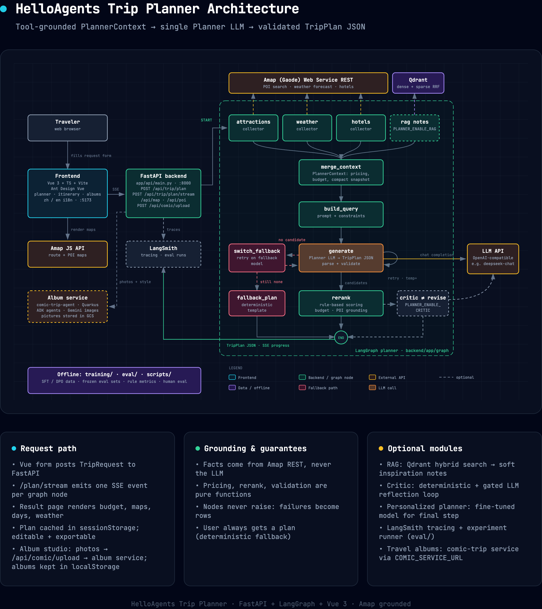
</p>

> PNG/PDF エクスポート付きのインタラクティブ版は [`docs/architecture.html`](docs/architecture.html) にあります。[architecture-diagram](https://github.com/Cocoon-AI/architecture-diagram-generator) スキルで生成しました。

### コンポーネント

| レイヤー | 技術 | 役割 |
| --- | --- | --- |
| フロントエンド | Vue 3, TypeScript, Vite, Ant Design Vue, Amap JS API | サイドメニュー、リクエストフォーム（`Home.vue`）、地図付きプラン表示（`Result.vue`）、アルバム作成と一覧（`AlbumWorkspace.vue`、`AlbumLibrary.vue`）、中/英 i18n |
| API | FastAPI | `POST /api/trip/plan`、`POST /api/trip/plan/stream`（SSE）、`POST /api/comic/upload`（アルバム用プロキシ）、地図/POI/RAG 補助ルート |
| プランナー | LangGraph ステートマシン（`backend/app/graph/`） | collect → merge → generate → rerank の制御（リトライ・フォールバック付き） |
| プランナーコア | `backend/app/planner/` | `PlannerContext`、価格算出、リランキング、出力検証、フォールバックプラン |
| 外部サービス | Amap Web Service、OpenAI 互換 LLM（例：`deepseek-chat`） | 旅行の事実データ、プラン生成 |
| オプション | Qdrant RAG、Critic ループ、LangSmith、comic-trip アルバムサービス | 旅行記からのヒント、自己レビュー、トレースと評価、イラストアルバム |

### リクエストのライフサイクル

1. **収集（ファンアウト）。** 3 つのコレクターが Amap に並列でアクセスし、観光地・天気・ホテルを取得します。`PLANNER_ENABLE_RAG=1` のときは RAG コレクターが 4 つ目として加わります。
2. **コンテキスト統合。** 結果を `PlannerContext` にまとめます。内容は候補 POI、ホテル・チケット・食事の価格ヒント、予算台帳、プロンプト用の圧縮スナップショットです。
3. **クエリ構築。** コンテキストとユーザーの制約から Planner 用プロンプトを作ります。
4. **生成（ループ）。** Planner LLM が `TripPlan` JSON を出力します。試行ごとに温度を上げて多様性を確保します。パースや検証の失敗は例外にせず記録します。どの試行でも候補が得られなければ、フォールバックモデルで再試行し、それでも駄目なら決定論的テンプレートを使います。
5. **リランキング。** ルールベースのスコアで、予算・実在性・重複の観点から最良の候補を選びます。オプションの **critic ⇄ revise** ループ（`PLANNER_ENABLE_CRITIC=1`）で、さらにレビューと修正ができます。
6. **ストリーム返却。** `/plan/stream` はグラフのノードごとに SSE 進捗イベントを送り、最後に最終プランを返します。

**重要な不変条件：** グラフのノードが例外で処理を中断することはありません。ユーザーは必ず何らかのプランを受け取ります。

## ユースケース：カップルが 4 日間の杭州旅行を計画する

> **シナリオ。** Lena と Tom は 11 月下旬に 4 日間杭州を訪れます。希望は、ゆったりしたペース、西湖での日の出散歩、本場の杭州料理のディナーです。海鮮は食べられず、予算は 2 人で ¥5,000 です。旅行の後は、撮った写真をイラスト入りのアルバムにしたいと考えています。
>
> 以下のスクリーンショットはすべて、2026-11-21 に本プロジェクトを実際に動かして取得したものです。モックは使っていません。

### 1. アプリを開き、英語に切り替える

Lena は `http://localhost:5173` を開き、右上の **中文 / EN** スイッチで UI を英語にします。サイドメニューは 2 つのグループに分かれています。**Create** には **Trip planner**（旅行プランナー）と **Album studio**（アルバム作成）があり、**My journeys** には **My itinerary**（直近のプラン）と **My albums**（アルバム一覧）があります。

<p align="center">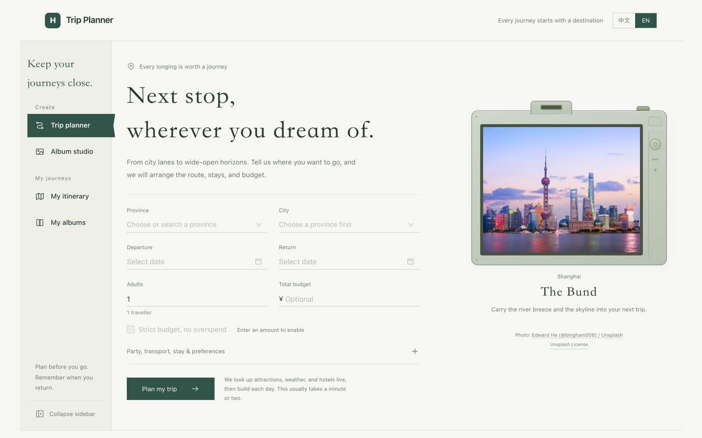</p>

### 2. 旅行内容を入力する

目的地は省と都市のリストから選びます。続いて **Party, transport, stay & preferences** を開き、残りを入力します：

| 項目 | 値 |
| --- | --- |
| 省 / 都市 | Zhejiang · 浙江省 / Hangzhou · 杭州市 |
| 出発 / 帰着 | 2026-11-22 → 2026-11-25（4 日間） |
| 大人 / 同行者タイプ | 大人 2 名、**Couple** |
| 予算 | ¥5,000、ソフト予算（厳守のチェックは外したまま）、レベル **Standard** |
| 現地交通 / 宿泊 | 公共交通機関、エコノミーホテル |
| 好み | History & culture、Food & dining、Photography spots、City walks |
| その他の要望 | *"Our first trip to Hangzhou. We want a relaxed pace, a sunrise walk by West Lake, and at least one authentic Hangzhou dinner. No seafood, please. Please write the whole itinerary in English."* |

<p align="center">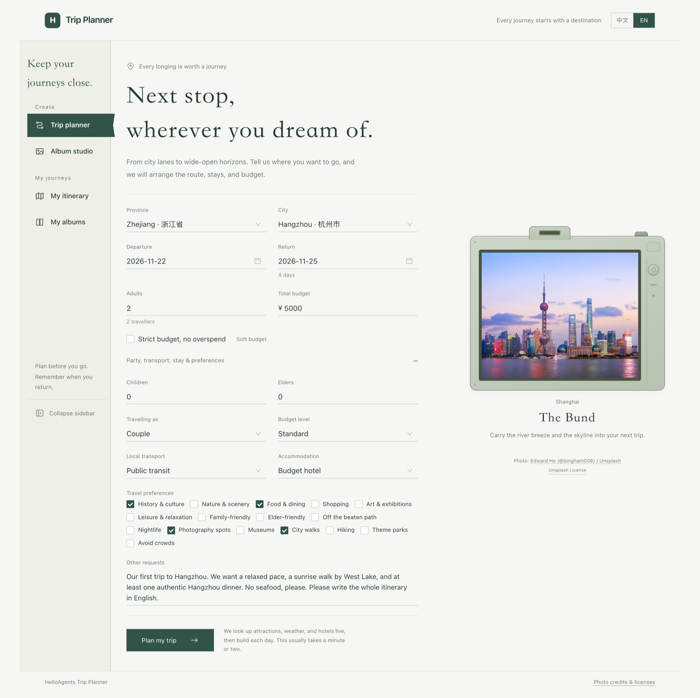</p>

### 3. プランナーの進捗を見る

**Plan my trip** をクリックすると、旅行準備票が SSE 経由で LangGraph のノードをリアルタイムに追います。スタンプは 4 つです：**Find info**（Amap コレクターの並列実行とコンテキスト統合）、**Shape route**（プランナー用クエリの構築）、**Arrange days**（候補プランの生成）、**Check plan**（候補のランキング）。今回は 70 秒でプランが完成しました。

<p align="center">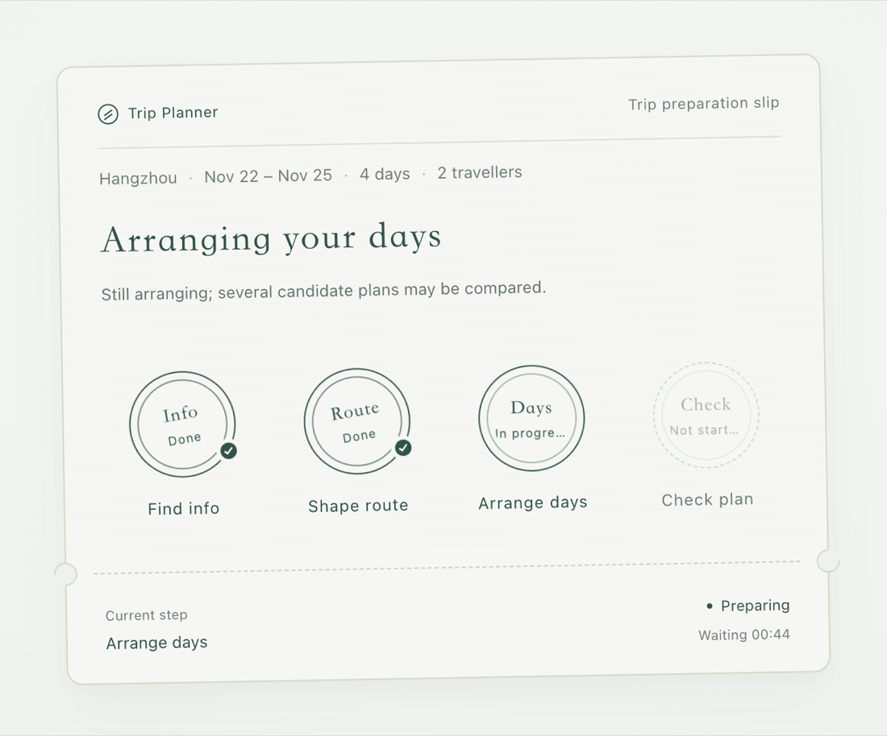</p>

### 4. 概要と天気を確認する

結果ページは **4 days in Hangzhou** から始まります。全体の提案には、初日の朝の白堤での日の出散歩、本場の杭州料理のディナー、海鮮なしと、すべての要望が反映されています。天気欄は Amap の実際の予報で、11/22 は晴れ 17/7 °C、11/23 は小雨 17/8 °C です。Amap の予報は数日先までなので、11/24〜25 は「No forecast」と表示されます。日程が近づいてから再生成すれば反映されます。

<p align="center">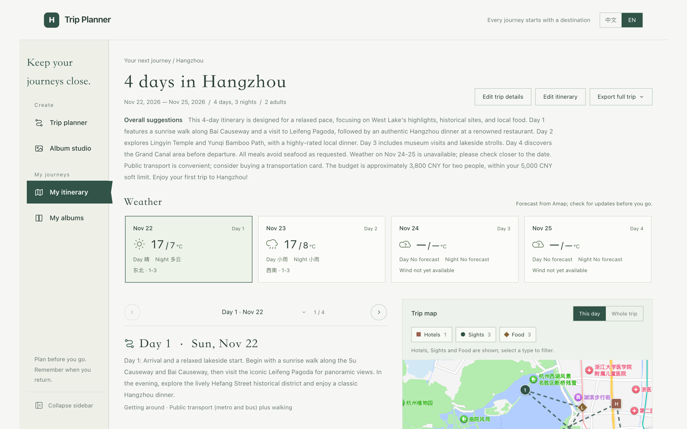</p>

### 5. 1 日ずつ旅程を確認する

日付スイッチで日を切り替えます。各日には訪問順に立ち寄り先が並び、滞在時間の目安・チケット代・住所が表示されます。隣の **Trip map** には同じ立ち寄り先が番号付きで表示され、ホテル（H）と食事（B・L・D）にも印が付きます。4 日間にはそれぞれテーマがあります：

| 日 | テーマ | 立ち寄り先 |
| --- | --- | --- |
| 1 日目・11/22 | 到着、湖畔でゆったり | 白堤、雷峰塔、清河坊 |
| 2 日目・11/23 | 霊隠寺とお茶の文化 | 霊隠寺（灵隐寺）、雲棲竹径（云栖竹径） |
| 3 日目・11/24 | 西湖南岸と博物館 | 南宋徳寿宮遺跡博物館（南宋德寿宫遗址博物馆）、太子湾公園（太子湾公园）、湖滨步行街 |
| 4 日目・11/25 | 大運河と出発 | 拱宸橋西歴史文化街区（拱宸桥西历史文化街区）、大兜路歴史文化街区（大兜路历史文化街区） |

地図の下の **Budget** パネルは **¥3,046** で、上限 ¥5,000 の 61% です。内訳は宿泊 ¥1,200、食事 ¥1,146、交通 ¥400、チケット ¥300 です。この数字は構造化されたプランから計算されます。概要文にあるモデルの見積もり（約 3,800 CNY）は大まかなので、パネルはそれを使いません。

観光地の写真は、Amap に写真があればそれを使います。なければキーワード検索の画像を **Stock reference** と表示して使います。実際の場所とは限らないためです。たとえば 3 日目の博物館の画像は、別の宮殿です。

<p align="center">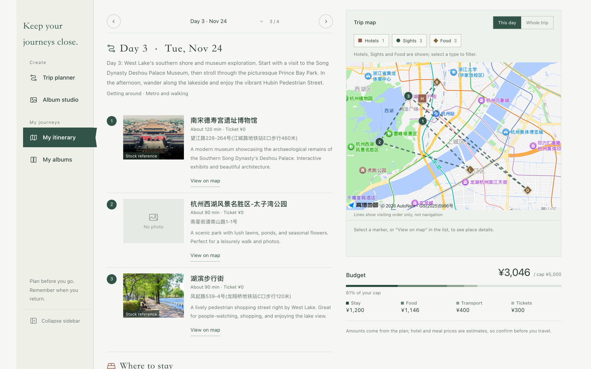</p>

### 6. 旅程全体を 1 枚の地図で見る

地図を **Whole trip** に切り替えると、4 日分がまとめて表示されます。ホテル 1 件、観光地 10 件、食事 12 件で、それぞれ日と順番のラベルが付きます（たとえば `2·1` は 2 日目の最初の立ち寄り先）。種類ボタンで絞り込めます。

<p align="center">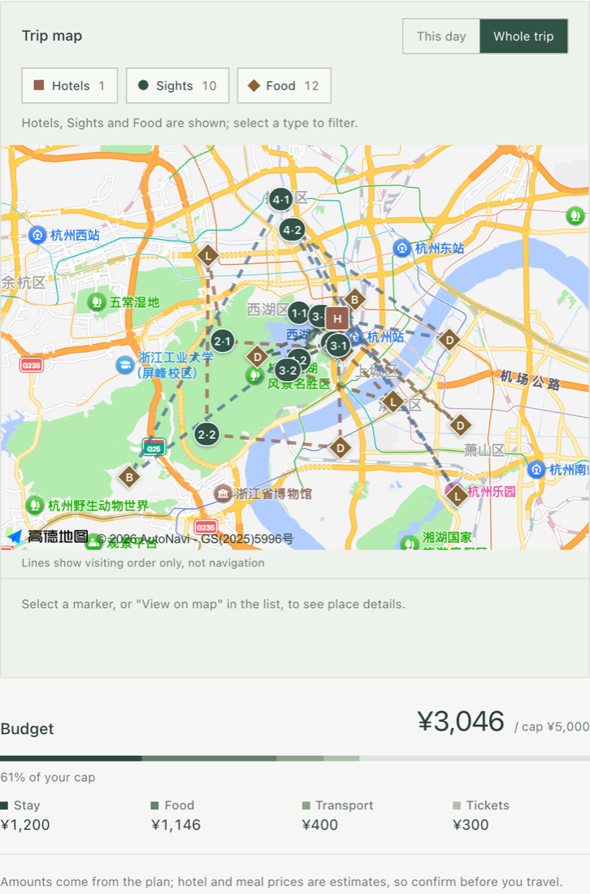</p>

### 7. 宿泊先と食事を確認する

場所はすべて Amap 上に実在する POI です。名称と住所は地図アプリで検索できるよう、中国語のまま表示されます。3 泊とも西湖近くのエコノミーホテル「花田赞酒店」で、1 泊約 ¥200 です。1 日目は朝食が「方老大」、昼食が老舗の「杭州酒家」、夕食が「绿茶餐厅」で、それぞれ 1 人あたりの目安額が付きます。**View on map** を押すと、その場所の詳細が地図に表示されます。

<p align="center">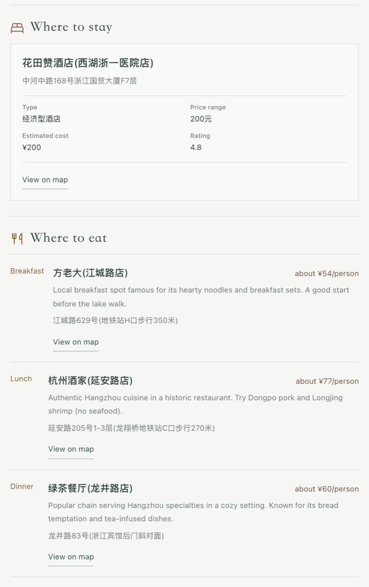</p>

ページ上部の **Edit itinerary** で立ち寄り先を変更し、**Edit trip details** でフォームに戻り、**Export full trip** でプランを Tom に共有できます。同じタブであれば、サイドメニューの **My itinerary** からいつでもこのプランに戻れます。

### 8. 旅行の後：写真をアルバムにする

帰宅後、Lena は **Album studio** を開きます。写真を最大 10 枚追加し、スタイル（**Comic**、**Watercolor journal**、**Retro film**、**Anime**）を選んで **Create album** をクリックします。バックエンドはファイルを検証してから、別サービスの comic-trip アルバムサービスに転送します。そこでエージェントが各写真の場所を特定し、Gemini でイラストを描き、近くのおすすめスポットを提案します。

今回は、杭州の湖畔のあずまやと上海のスカイラインの 2 枚をアップロードし、**Watercolor journal** を選びました。

<p align="center">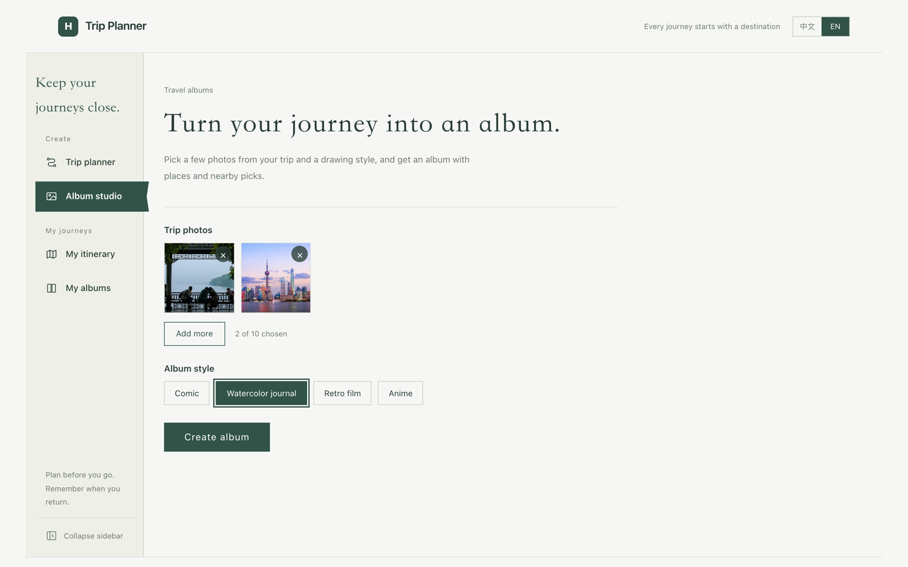</p>

約 2 分後にアルバムが完成しました。サービスが付けたタイトルは *Shanghai: Past and Future* です。各ページには場所、説明、近くのスポット一覧が付きます。西湖のページなら湖心亭や白堤などです。

<p align="center">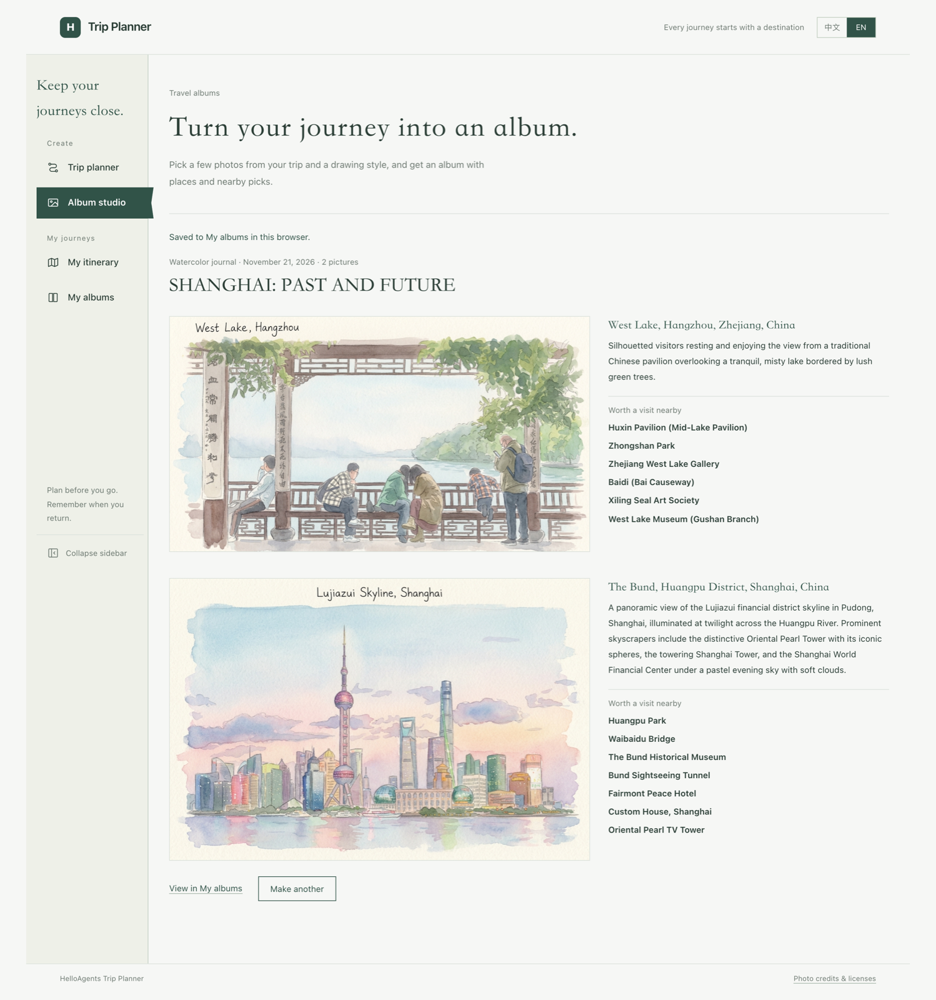</p>

アルバムはこのブラウザの **My albums** にのみ保存されます（`localStorage`、最大 30 件）。別の端末には引き継がれません。

<p align="center">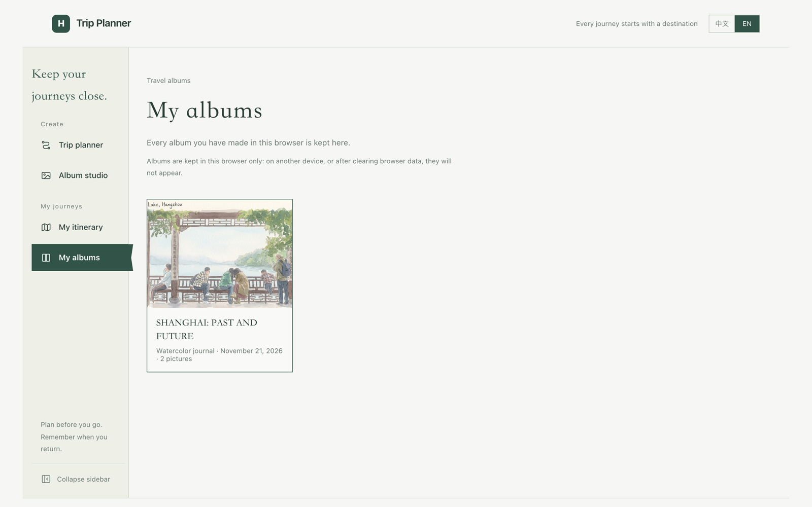</p>

> 元の写真 2 枚は、アプリに同梱している Unsplash の写真です（Unsplash License）：[西湖](https://unsplash.com/photos/a-group-of-people-sitting-on-a-bench-next-to-a-body-of-water-WGpESYTfQHE)、[外灘](https://unsplash.com/photos/orient-pearl-shanghai-china-taken-during-daytime-uKyzXEc2k_s)。

## 起動方法

### 前提条件

- Python **3.11 以上**、Node.js **22**
- **Amap（高徳地図）** の Web Service キー（バックエンド用）と Web JS API キー（フロントエンドの地図用）：<https://lbs.amap.com/>
- **OpenAI 互換**の LLM エンドポイント。*推論（reasoning）モデルではない*チャットモデルを使ってください（例：`deepseek-chat`）
- 任意：Unsplash キー（観光地の写真）、Docker（RAG 用のローカル Qdrant）、LangSmith キー（トレース）、comic-trip アルバムサービス（旅行アルバム）

### 1. バックエンド

```bash
cd backend
python -m venv .venv && source .venv/bin/activate
pip install -r requirements.txt
cp .env.example .env
```

`backend/.env` に最低限次の値を設定します：

```bash
AMAP_API_KEY=your_amap_web_service_key
LLM_PROVIDER=openai
LLM_MODEL_ID=deepseek-chat
LLM_API_KEY=your_llm_api_key
LLM_BASE_URL=https://api.deepseek.com
PORT=7000
```

起動します：

```bash
python run.py
```

- API：`http://localhost:7000`
- Swagger UI：`http://localhost:7000/docs`
- ヘルスチェック：`http://localhost:7000/health`

> **macOS の注意：** AirPlay レシーバーがポート 7000 を使っていることがよくあります。その場合は `PORT=8000` に変更し、`frontend/vite.config.ts` のプロキシ先も合わせてください。

### 2. フロントエンド

```bash
cd frontend
npm ci
cp .env.example .env
```

`frontend/.env` に次の値を設定します：

```bash
VITE_API_BASE_URL=            # 開発時は空のままにすると Vite の /api プロキシを使います
VITE_AMAP_WEB_KEY=your_amap_web_key
VITE_AMAP_WEB_JS_KEY=your_amap_web_js_key
```

開発サーバーを起動します：

```bash
npm run dev -- --host 0.0.0.0 --port 5173
```

<http://localhost:5173> を開きます。

### 3. オプションモジュール

| モジュール | 有効化 | 備考 |
| --- | --- | --- |
| RAG 旅行ノート | `PLANNER_ENABLE_RAG=1` + `QDRANT_URL`、`MODELSCOPE_API_KEY` | `docker compose up -d` でローカル Qdrant が起動します。データは `backend/scripts/rag_import.py` で取り込みます。ノートは参考情報としてのみ使います |
| Critic 振り返りループ | `PLANNER_ENABLE_CRITIC=1`、`PLANNER_MAX_REVISE=2` | 決定論的チェックの後に、条件付きで LLM レビューを行います |
| LangSmith トレース / 評価 | `LANGSMITH_TRACING=true` + `LANGSMITH_API_KEY` | 実験ランナーは [`eval/`](eval/) を参照 |
| 旅行アルバム | `COMIC_SERVICE_URL=http://localhost:8080`、`COMIC_SERVICE_TIMEOUT_SECONDS=330` | 別サービスの comic-trip-agent（Quarkus、Java 21）を、`GEMINI_API_KEY` と書き込み可能な GCS バケット（`COMIC_TRIP_PICTURE_BUCKET`）付きで起動しておく必要があります。バックエンドは先にアップロードを検証します：最大 10 枚、1 枚 15 MB、合計 95 MB |

### 4. テスト

```bash
cd backend
pytest                       # フルスイート。フェイクを注入してオフラインで動作
UPDATE_GOLDEN=1 pytest       # 価格・スコアリングを意図的に変更した後、ゴールデンを再生成
cd ../frontend && npm run build   # 型チェック + 本番ビルド
```

## トラブルシューティング

| 症状 | 原因 | 対処 |
| --- | --- | --- |
| 毎回汎用のフォールバックプランが返り、ログに `EmptyLLMResponseError` が出る | `LLM_MODEL_ID` が推論モデルです。`max_tokens` を `reasoning_content` で使い切り、`content` が空になります | `deepseek-chat` などの非推論チャットモデルを使う |
| RAG 有効化後に Planner LLM が 401 を返す | `HelloAgentsLLM` が `MODELSCOPE_API_KEY` を検出し、プロバイダーを自動で切り替えます | `LLM_PROVIDER=openai` で固定する |
| 別の都市のホテルやレストランが出る（API 直接呼び出し時） | `Hangzhou` のようなローマ字の都市名は Amap で曖昧にマッチします。Web フォームは都市をリストから選ぶので、この問題は起きません | `杭州市` のように中国語で送る |
| 天気が「正確な予報なし」と表示される | Amap の予報は今後約 4 日分のみです | 先の日程では想定どおりの動作で、プラン自体は生成されます |
| 旅程の文章が中国語になる | Planner LLM はデフォルトでコンテキストの言語に従います | メモに "Please write the itinerary in English" と書き添える |
| アルバム作成画面でサービス未設定と表示される | `backend/.env` の `COMIC_SERVICE_URL` が空です | comic-trip サービス（例：`http://localhost:8080`）を設定し、バックエンドを再起動する |
| アップロード直後にアルバム生成が失敗する | comic-trip サービスが Gemini または GCS にアクセスできません。Quarkus は自身の設定に `.env` を読みますが、Gemini SDK は `GEMINI_API_KEY` をプロセスの環境変数からしか読みません | 起動前に変数を export し（`set -a && . ./.env && set +a`）、`COMIC_TRIP_PICTURE_BUCKET` を書き込み権限のあるバケットにする |
| 観光地の写真が別の場所を写している | Amap に写真がなく、キーワード検索の画像を使っています | 想定どおりの動作です。こうした画像には **Stock reference** と表示されます |

## ディレクトリ構成

```text
backend/        FastAPI アプリ、LangGraph プランナー（app/graph）、プランナーコア（app/planner）、RAG、サービス
frontend/       Vue 3 + Vite の Web アプリ
training/       SFT / DPO データ、固定評価セット、ルール指標、後学習ドキュメント
eval/           LangSmith 実験ランナーと LLM-as-judge 評価器
scripts/        オフライン生成スクリプト（RAG シードコーパス、人手評価用プラン）→ out/
docs/           アーキテクチャ図、Dify 参考ワークフロー、README 用画像
```

ディレクトリの詳細は [PROJECT_STRUCTURE.md](PROJECT_STRUCTURE.md) を参照してください。

## ライセンス

CC BY-NC-SA 4.0

## 謝辞

- [HelloAgents](https://github.com/datawhalechina/Hello-Agents)
- [Amap（高徳地図）オープンプラットフォーム](https://lbs.amap.com/)
- [architecture-diagram-generator](https://github.com/Cocoon-AI/architecture-diagram-generator)（Cocoon AI）
