<div align="center">

# HelloAgents Trip Planner

**English** | [日本語](README.ja.md)

An AI trip planner that turns a short request into a day-by-day itinerary, with a budget, maps, hotels, meals, and weather, all grounded in real map data. After the trip, it turns your photos into an illustrated travel album.

</div>

---

## Table of Contents

- [Why this project](#why-this-project)
- [Architecture](#architecture)
- [Use case: a couple plans a 4-day trip to Hangzhou](#use-case-a-couple-plans-a-4-day-trip-to-hangzhou)
- [Getting started](#getting-started)
- [Troubleshooting](#troubleshooting)
- [Project layout](#project-layout)
- [License](#license)

## Why this project

Most LLM trip planners let the model invent everything: attractions, opening hours, prices, hotels. This project does not trust the model with facts.

- **The facts come from tools.** Attractions, hotels, restaurants, and weather are fetched from the Amap (Gaode) REST API. Ticket, hotel, and meal prices come from deterministic pricing rules.
- **The model only plans.** The backend compiles everything into an auditable `PlannerContext`. A single Planner LLM then arranges those facts into a structured `TripPlan` JSON.
- **The output is checked.** Every candidate plan is parsed, validated, and scored by rules for budget fit, POI grounding, and duplicates. If the LLM fails, a deterministic fallback still gives the user a usable plan.

## Architecture

<p align="center">
  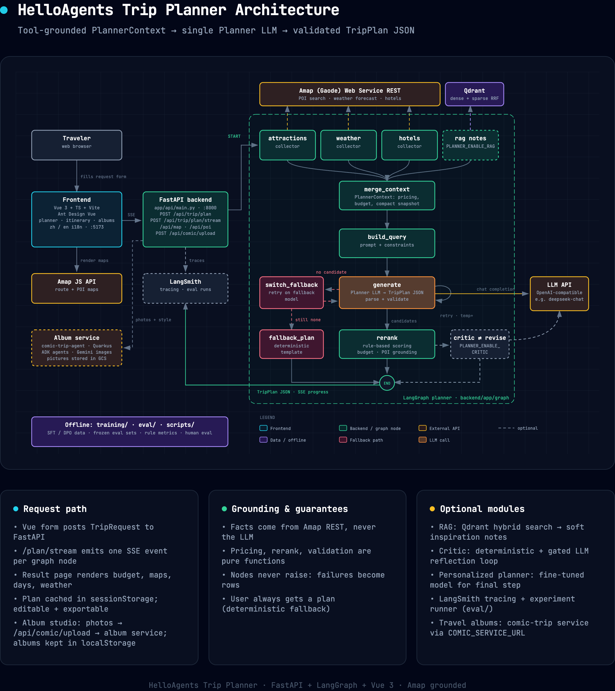
</p>

> An interactive version (with PNG/PDF export) is in [`docs/architecture.html`](docs/architecture.html). It was generated with the [architecture-diagram](https://github.com/Cocoon-AI/architecture-diagram-generator) skill.

### Components

| Layer | Tech | Responsibility |
| --- | --- | --- |
| Frontend | Vue 3, TypeScript, Vite, Ant Design Vue, Amap JS API | Side menu, request form (`Home.vue`), plan viewer with maps (`Result.vue`), album studio and library (`AlbumWorkspace.vue`, `AlbumLibrary.vue`), zh/en i18n |
| API | FastAPI | `POST /api/trip/plan`, `POST /api/trip/plan/stream` (SSE), `POST /api/comic/upload` (album proxy), map/POI/RAG helper routes |
| Planner | LangGraph state machine (`backend/app/graph/`) | Orchestrates collect → merge → generate → rerank, with retry and fallback |
| Planner core | `backend/app/planner/` | `PlannerContext`, pricing, rerank scoring, output validation, fallback plan |
| External | Amap Web Service, OpenAI-compatible LLM (e.g. `deepseek-chat`) | Ground-truth travel data; plan generation |
| Optional | Qdrant RAG, Critic loop, LangSmith, comic-trip album service | Travel-post inspiration, self-review, tracing and evaluation, illustrated albums |

### Request lifecycle

1. **Collect (fan-out).** Three collectors call Amap in parallel for attractions, weather, and hotels. A fourth RAG collector is added when `PLANNER_ENABLE_RAG=1`.
2. **Merge context.** Results are compiled into a `PlannerContext`: candidate POIs, price hints for hotels, tickets, and meals, the budget ledger, and a compact snapshot for the prompt.
3. **Build query.** The context and user constraints become the Planner prompt.
4. **Generate (loop).** The Planner LLM produces `TripPlan` JSON, and each attempt raises the temperature for diversity. Every parse or validation failure is recorded instead of raised. If no attempt yields a candidate, the graph retries on the fallback model, then falls back to a deterministic template.
5. **Rerank.** A rule-based score picks the best candidate for budget, grounding, and duplicates. The optional **critic ⇄ revise** loop (`PLANNER_ENABLE_CRITIC=1`) can then review and repair it.
6. **Stream back.** `/plan/stream` emits one SSE progress event per graph node, then the final plan.

**Key invariant:** graph nodes never raise to abort a run. The user always gets *a* plan.

## Use case: a couple plans a 4-day trip to Hangzhou

> **Scenario.** Lena and Tom are visiting Hangzhou for four days in late November. They want a relaxed pace, a sunrise walk by West Lake, and an authentic local dinner. They don't eat seafood, and their budget is ¥5,000 for two. After the trip, they want to turn their photos into an illustrated album.
>
> All screenshots below come from a real run of this project on 2026-11-21. Nothing was mocked.

### 1. Open the app and switch to English

Lena opens `http://localhost:5173` and uses the **中文 / EN** switch in the top-right corner to set the UI to English. The side menu has two groups. **Create** holds the **Trip planner** and the **Album studio**. **My journeys** holds **My itinerary** (the last plan) and **My albums**.

<p align="center">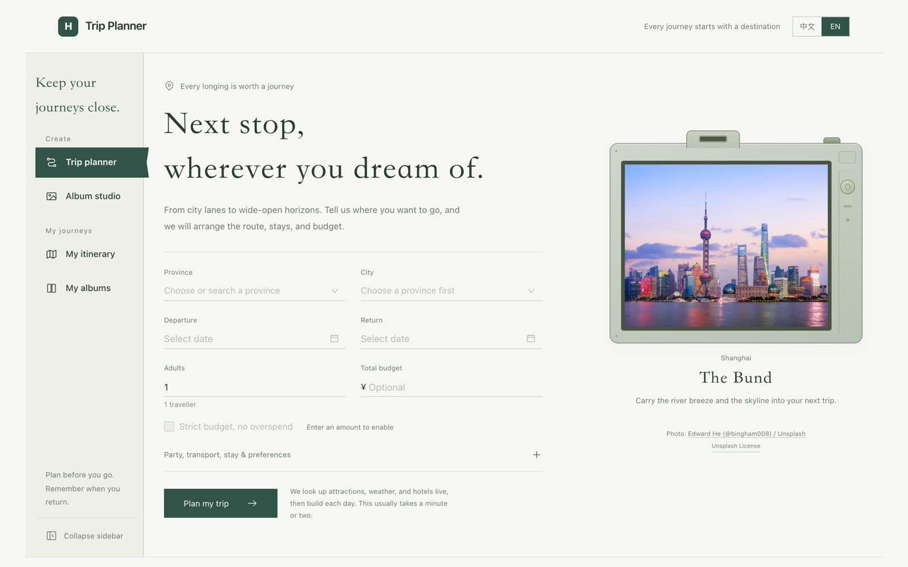</p>

### 2. Describe the trip

She picks the destination from the province and city lists, then opens **Party, transport, stay & preferences** to fill in the rest:

| Field | Value |
| --- | --- |
| Province / City | Zhejiang · 浙江省 / Hangzhou · 杭州市 |
| Departure / Return | 2026-11-22 → 2026-11-25 (4 days) |
| Adults / Travelling as | 2 adults, **Couple** |
| Total budget | ¥5,000, soft budget (the strict box is left unchecked), level **Standard** |
| Local transport / Accommodation | Public transit, Budget hotel |
| Travel preferences | History & culture, Food & dining, Photography spots, City walks |
| Other requests | *"Our first trip to Hangzhou. We want a relaxed pace, a sunrise walk by West Lake, and at least one authentic Hangzhou dinner. No seafood, please. Please write the whole itinerary in English."* |

<p align="center">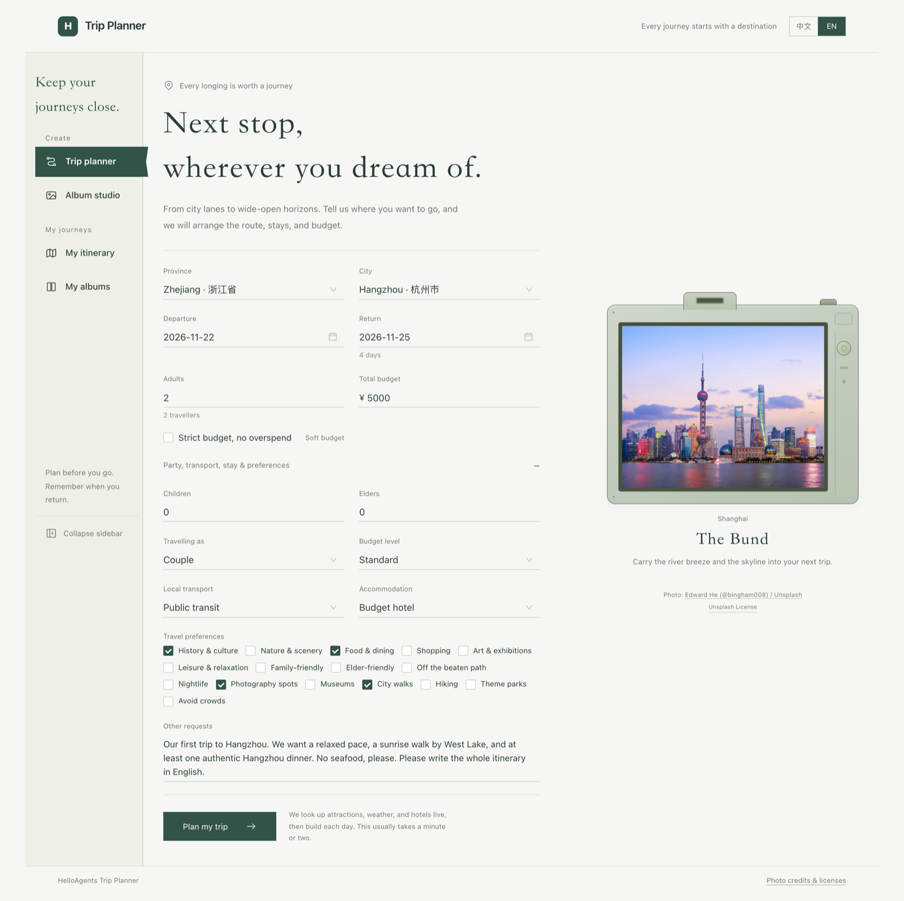</p>

### 3. Watch the planner work

After she clicks **Plan my trip**, a trip preparation slip follows the LangGraph nodes live over SSE. It has four stamps: **Find info** (the parallel Amap collectors and the merged context), **Shape route** (building the planner query), **Arrange days** (generating candidate plans), and **Check plan** (ranking them). In this run the plan was ready after 70 seconds.

<p align="center">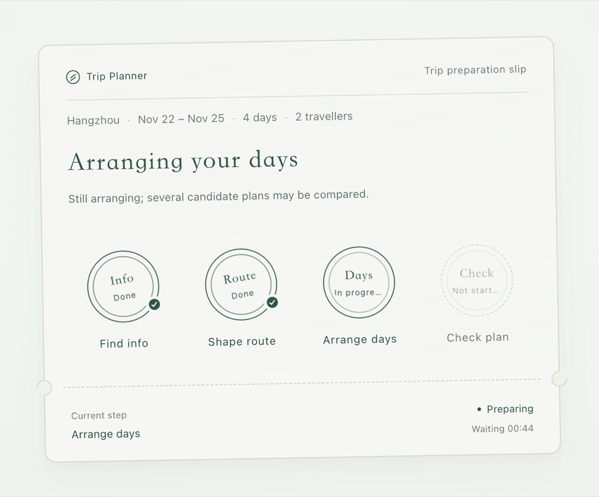</p>

### 4. Read the overview and the weather

The result page opens on **4 days in Hangzhou**. The overall suggestions cover every request: a sunrise walk on the Bai Causeway on the first morning, an authentic Hangzhou dinner, and no seafood. The weather strip shows Amap's real forecast: sunny, 17/7 °C on Nov 22 and light rain, 17/8 °C on Nov 23. Amap forecasts only a few days ahead, so Nov 24–25 show "No forecast" until Lena regenerates closer to the date.

<p align="center">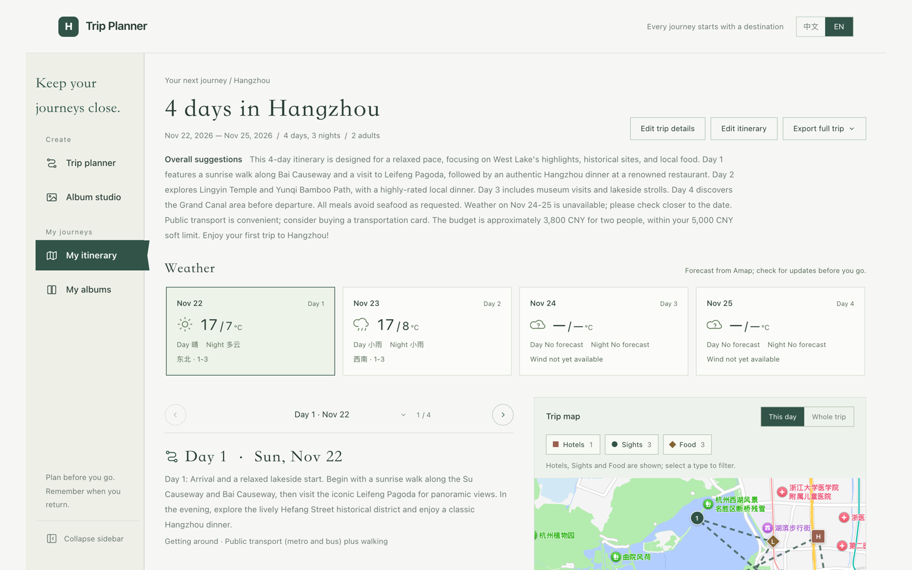</p>

### 5. Go through the trip day by day

The day switcher moves between days. Each day lists its stops in visiting order, with a suggested duration, the ticket price, and the address. The **Trip map** next to it numbers the same stops and marks the hotel (H) and meals (B, L, D). The four days have different themes:

| Day | Theme | Stops |
| --- | --- | --- |
| 1 · Nov 22 | Arrival, relaxed lakeside start | Bai Causeway (白堤), Leifeng Pagoda (雷峰塔), Qinghefang Street (清河坊) |
| 2 · Nov 23 | Lingyin Temple and tea culture | Lingyin Temple (灵隐寺), Yunqi Bamboo Path (云栖竹径) |
| 3 · Nov 24 | The lake's southern shore and a museum | Deshou Palace Museum (南宋德寿宫遗址博物馆), Prince Bay Park (太子湾公园), Hubin Pedestrian Street (湖滨步行街) |
| 4 · Nov 25 | Grand Canal and departure | Gongchen Bridge historic block (拱宸桥西历史文化街区), Dadou Road historic block (大兜路历史文化街区) |

Below the map, the **Budget** panel shows **¥3,046**, or 61% of the ¥5,000 cap: stay ¥1,200, food ¥1,146, transport ¥400, and tickets ¥300. These figures come from the structured plan. The model's prose estimate in the overview ("about 3,800 CNY") is looser, which is why the panel never relies on it.

Attraction photos come from Amap when it has one. Otherwise the page shows an image from a keyword search, labelled **Stock reference**, because it may not show the actual place. On Day 3, for example, the museum's stock image shows a different palace.

<p align="center">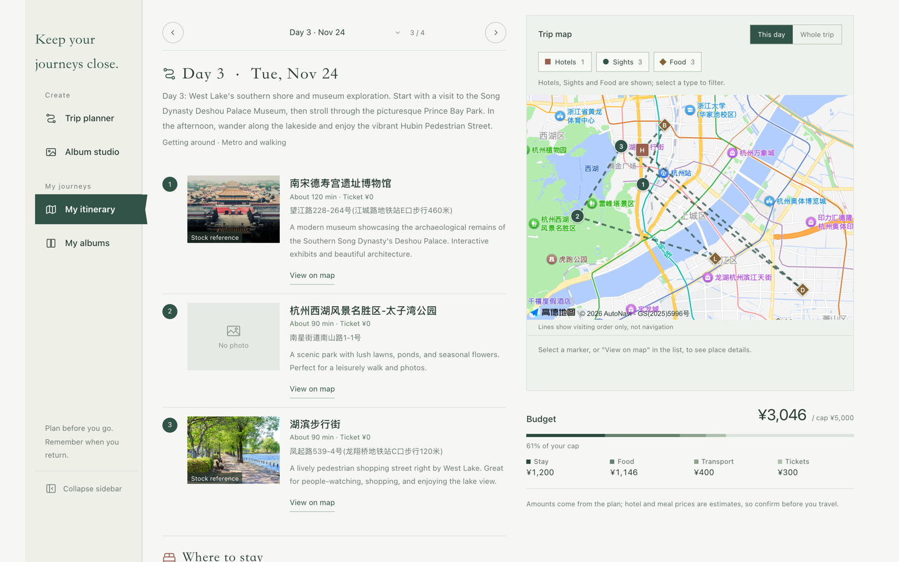</p>

### 6. See the whole trip on one map

Switching the map to **Whole trip** shows all 4 days at once: 1 hotel, 10 sights, and 12 meals, each labelled by day and stop (for example, `2·1` is the first stop on Day 2). The type buttons filter the markers.

<p align="center">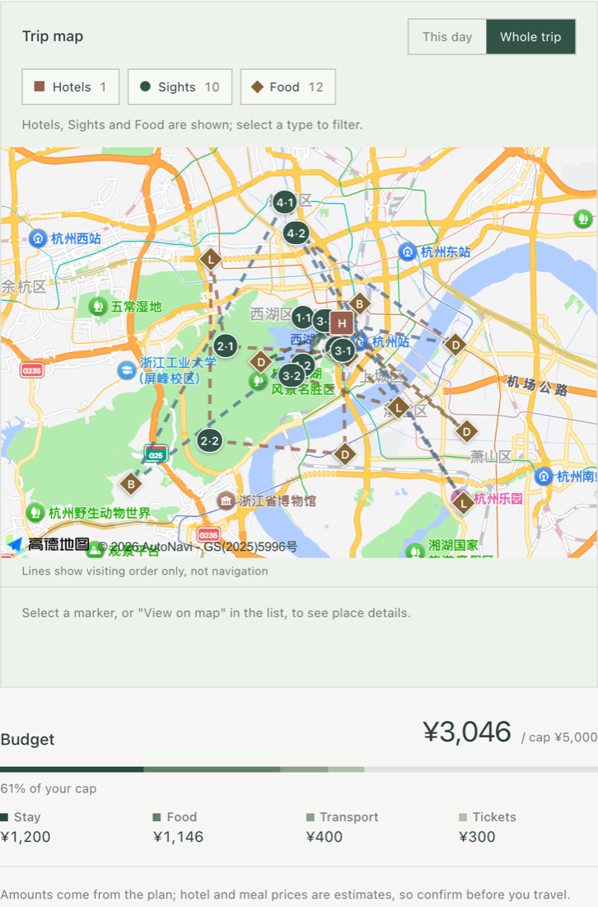</p>

### 7. Check where to stay and eat

Every place is a real Amap POI, and its name and address stay in Chinese so they can be searched in any map app. All three nights are at 花田赞酒店, a budget hotel near West Lake at about ¥200 a night. Day 1 has breakfast at 方老大, lunch at the classic Hangzhou Restaurant (杭州酒家), and dinner at 绿茶餐厅, with a per-person estimate for each. **View on map** shows the place's details on the trip map.

<p align="center">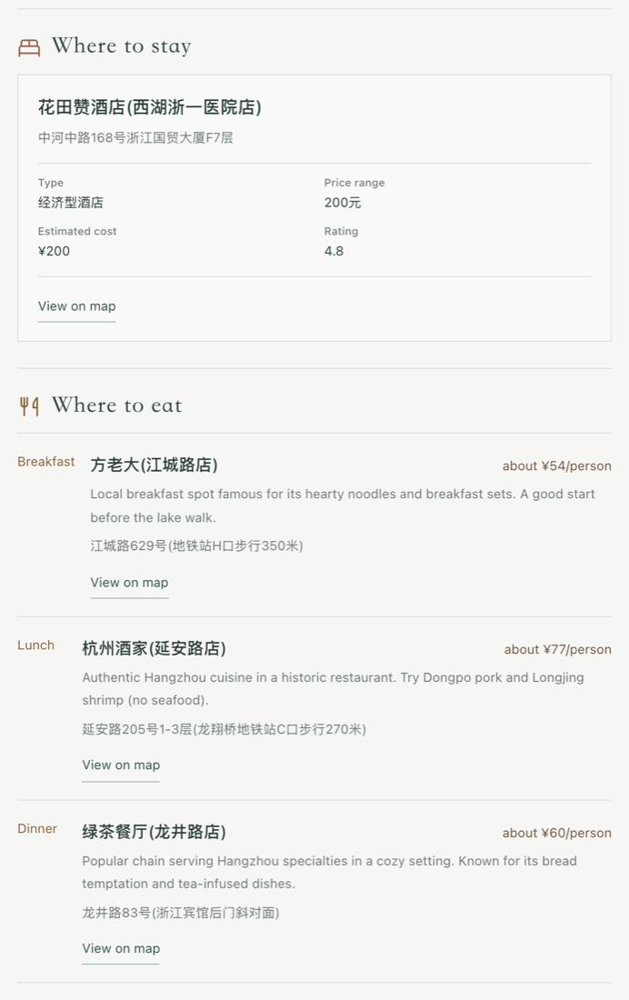</p>

From the top of the page, Lena can use **Edit itinerary** to change stops, **Edit trip details** to go back to the form, or **Export full trip** to share the plan with Tom. **My itinerary** in the side menu brings her back to this plan later in the same tab.

### 8. After the trip: turn photos into an album

Back home, Lena opens **Album studio**. She adds up to 10 photos, picks a style (**Comic**, **Watercolor journal**, **Retro film**, or **Anime**), and clicks **Create album**. The backend checks the files and forwards them to the separate comic-trip album service, where agents identify each place, draw an illustration with Gemini, and suggest nearby places worth a visit.

In this run, she uploaded two photos, a lakeside pavilion in Hangzhou and the Shanghai skyline, and chose **Watercolor journal**.

<p align="center">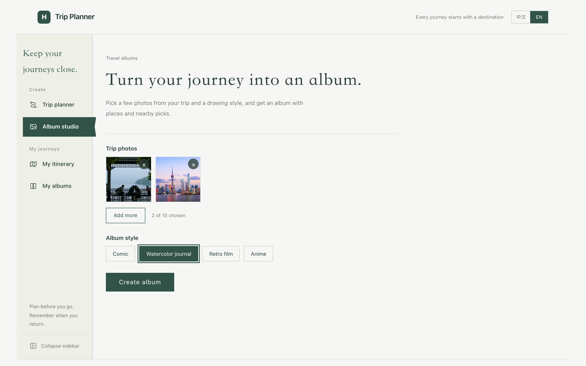</p>

About two minutes later, the album was ready. The service titled it *Shanghai: Past and Future*. Each picture comes with its location, a description, and a list of nearby places, such as the Mid-Lake Pavilion and Bai Causeway for West Lake.

<p align="center">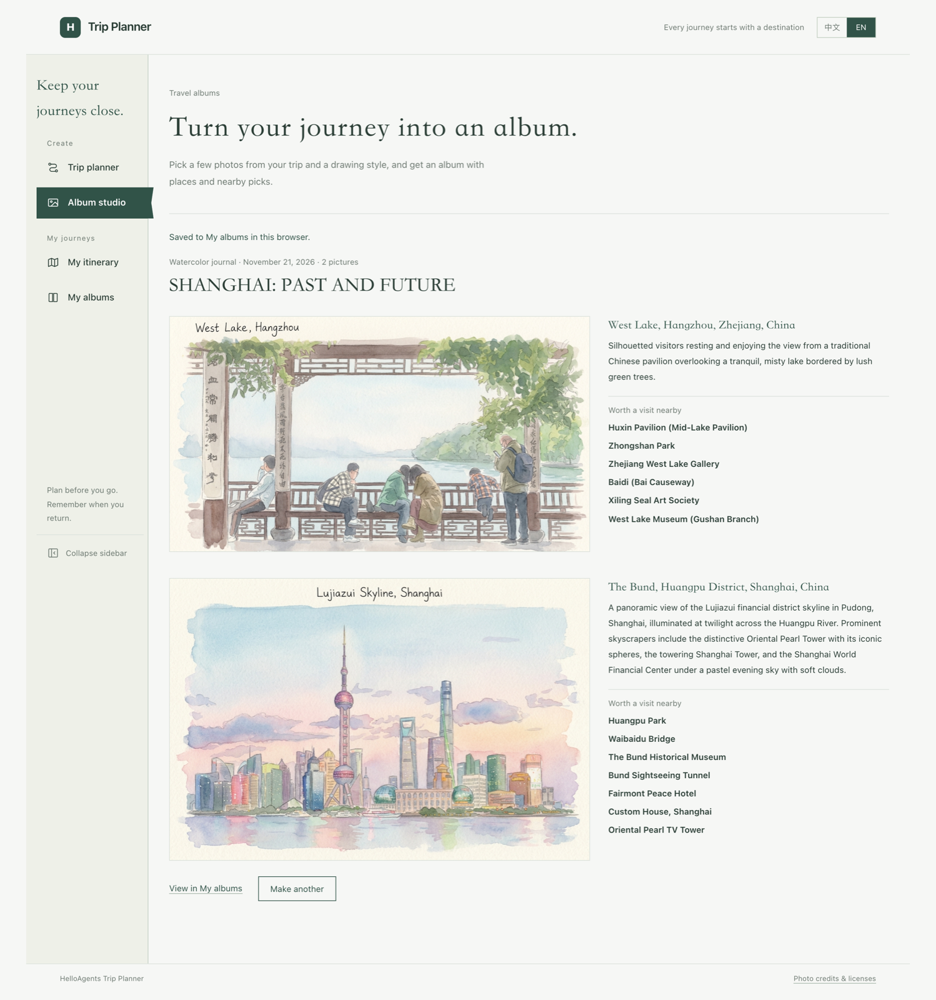</p>

The album is saved to **My albums** in this browser only (`localStorage`, up to 30 albums), so it does not follow Lena to another device.

<p align="center">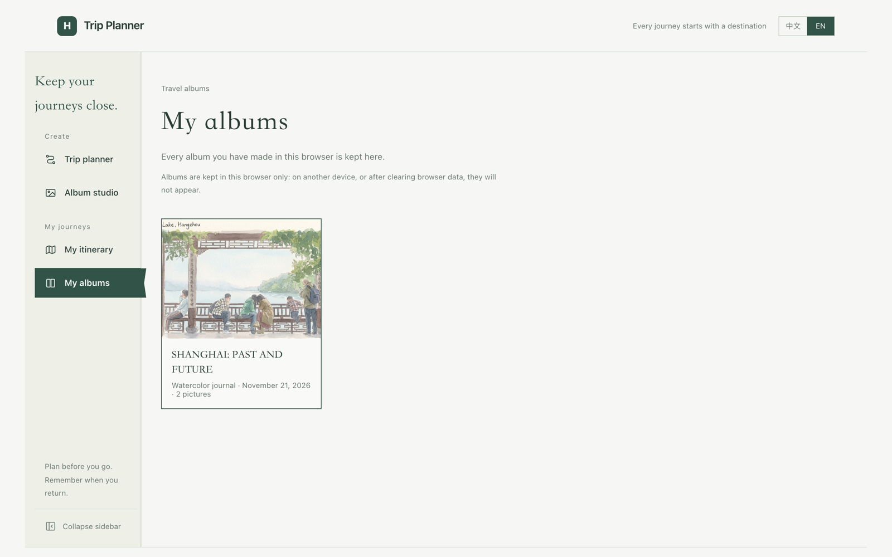</p>

> The two source photos are Unsplash photos bundled with the app (Unsplash License): [West Lake](https://unsplash.com/photos/a-group-of-people-sitting-on-a-bench-next-to-a-body-of-water-WGpESYTfQHE) and [the Bund](https://unsplash.com/photos/orient-pearl-shanghai-china-taken-during-daytime-uKyzXEc2k_s).

## Getting started

### Prerequisites

- Python **3.11+** and Node.js **22**
- An **Amap (Gaode)** Web Service key (backend) and a Web JS API key (frontend maps): <https://lbs.amap.com/>
- An **OpenAI-compatible** LLM endpoint using a *non-reasoning* chat model, e.g. `deepseek-chat`
- Optional: Unsplash key (attraction photos), Docker (local Qdrant for RAG), LangSmith key (tracing), the comic-trip album service (travel albums)

### 1. Backend

```bash
cd backend
python -m venv .venv && source .venv/bin/activate
pip install -r requirements.txt
cp .env.example .env
```

Set at least these values in `backend/.env`:

```bash
AMAP_API_KEY=your_amap_web_service_key
LLM_PROVIDER=openai
LLM_MODEL_ID=deepseek-chat
LLM_API_KEY=your_llm_api_key
LLM_BASE_URL=https://api.deepseek.com
PORT=7000
```

Start it:

```bash
python run.py
```

- API: `http://localhost:7000`
- Swagger UI: `http://localhost:7000/docs`
- Health check: `http://localhost:7000/health`

> **macOS note:** the AirPlay Receiver often occupies port 7000. If so, set `PORT=8000` and update the proxy target in `frontend/vite.config.ts` to match.

### 2. Frontend

```bash
cd frontend
npm ci
cp .env.example .env
```

Set the following in `frontend/.env`:

```bash
VITE_API_BASE_URL=            # leave empty to use the Vite /api proxy in dev
VITE_AMAP_WEB_KEY=your_amap_web_key
VITE_AMAP_WEB_JS_KEY=your_amap_web_js_key
```

Start the dev server:

```bash
npm run dev -- --host 0.0.0.0 --port 5173
```

Open <http://localhost:5173>.

### 3. Optional modules

| Module | Enable with | Notes |
| --- | --- | --- |
| RAG travel notes | `PLANNER_ENABLE_RAG=1` + `QDRANT_URL`, `MODELSCOPE_API_KEY` | `docker compose up -d` starts a local Qdrant. Import data with `backend/scripts/rag_import.py`. Notes are soft inspiration only. |
| Critic reflection loop | `PLANNER_ENABLE_CRITIC=1`, `PLANNER_MAX_REVISE=2` | Deterministic checks first, then a gated LLM review |
| LangSmith tracing / eval | `LANGSMITH_TRACING=true` + `LANGSMITH_API_KEY` | See [`eval/`](eval/) for the experiment runner |
| Travel albums | `COMIC_SERVICE_URL=http://localhost:8080`, `COMIC_SERVICE_TIMEOUT_SECONDS=330` | Needs the separate comic-trip-agent service (Quarkus, Java 21) running with `GEMINI_API_KEY` and a writable GCS bucket in `COMIC_TRIP_PICTURE_BUCKET`. The backend checks uploads first: up to 10 images, 15 MB each, 95 MB in total. |

### 4. Tests

```bash
cd backend
pytest                       # full suite, runs offline with injected fakes
UPDATE_GOLDEN=1 pytest       # regenerate golden baselines after intentional pricing/scoring changes
cd ../frontend && npm run build   # type-check + production build
```

## Troubleshooting

| Symptom | Cause | Fix |
| --- | --- | --- |
| Every request returns the generic fallback plan; logs show `EmptyLLMResponseError` | `LLM_MODEL_ID` is a reasoning model. It spends `max_tokens` on `reasoning_content` and leaves `content` empty. | Use a non-reasoning chat model, e.g. `deepseek-chat` |
| 401 errors from the planner LLM after enabling RAG | `HelloAgentsLLM` auto-detects `MODELSCOPE_API_KEY` and switches provider | Pin `LLM_PROVIDER=openai` |
| Hotels or restaurants from the wrong city (API calls) | Romanized city names (e.g. `Hangzhou`) are matched loosely by Amap. The web form avoids this by picking from a city list. | Send the city in Chinese, e.g. `杭州市` |
| Weather shows "no accurate forecast" | Amap forecasts only cover the next ~4 days | Expected for trips further out; the plan still generates |
| Itinerary text is in Chinese | The Planner LLM follows the context language by default | Add "Please write the itinerary in English" to the notes |
| Album studio says the service is not configured | `COMIC_SERVICE_URL` is empty in `backend/.env` | Set it to the comic-trip service, e.g. `http://localhost:8080`, and restart the backend |
| Album generation fails right after upload | The comic-trip service cannot reach Gemini or GCS. Quarkus reads its `.env` for its own config, but the Gemini SDK reads `GEMINI_API_KEY` from the process environment only. | Export the variables before starting it (`set -a && . ./.env && set +a`), and point `COMIC_TRIP_PICTURE_BUCKET` at a bucket your credentials can write to |
| Attraction photo shows a different place | No Amap photo was found, so a keyword image search was used | Expected: such images are labelled **Stock reference** |

## Project layout

```text
backend/        FastAPI app, LangGraph planner (app/graph), planner core (app/planner), RAG, services
frontend/       Vue 3 + Vite web app
training/       SFT / DPO data, frozen eval sets, rule metrics, post-training docs
eval/           LangSmith experiment runner and LLM-as-judge evaluators
scripts/        Offline generators (RAG seed corpus, human-eval plans) → out/
docs/           Architecture diagram, Dify reference workflows, README images
```

See [PROJECT_STRUCTURE.md](PROJECT_STRUCTURE.md) for the full directory map.

## License

CC BY-NC-SA 4.0

## Acknowledgements

- [HelloAgents](https://github.com/datawhalechina/Hello-Agents)
- [Amap (Gaode) Open Platform](https://lbs.amap.com/)
- [architecture-diagram-generator](https://github.com/Cocoon-AI/architecture-diagram-generator) by Cocoon AI
