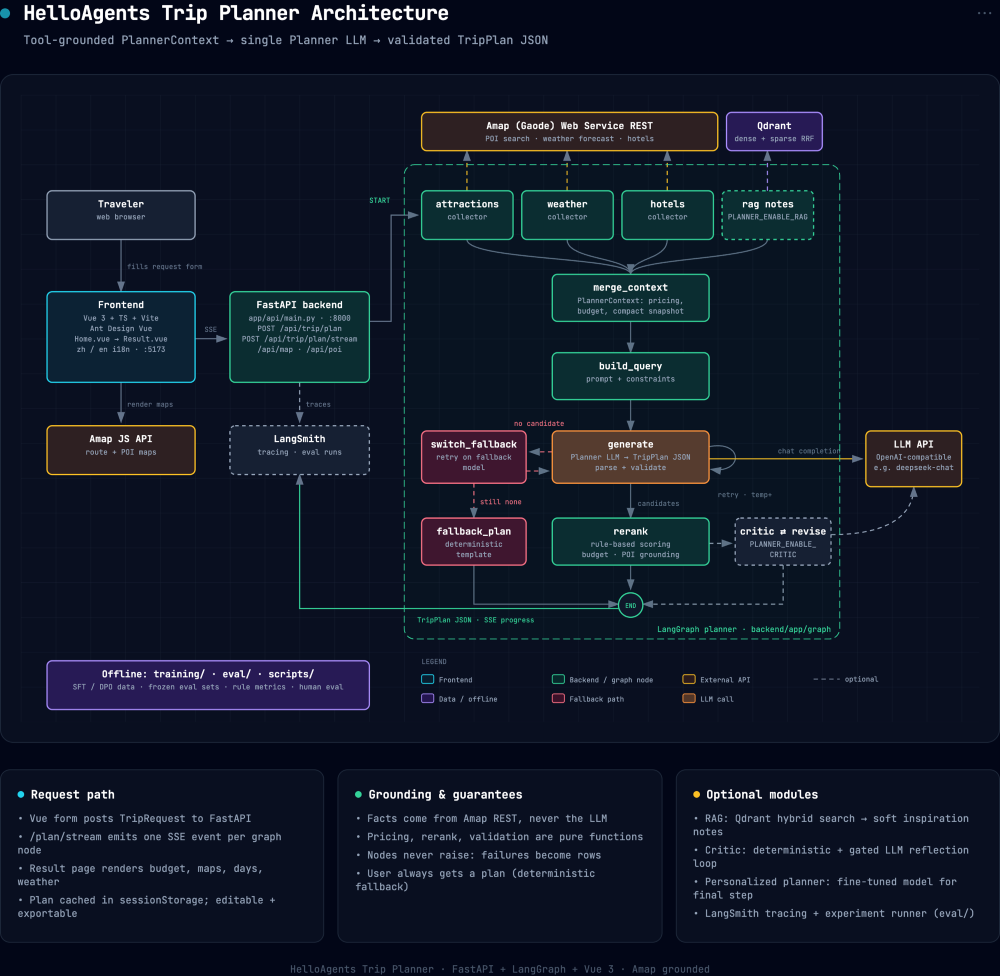
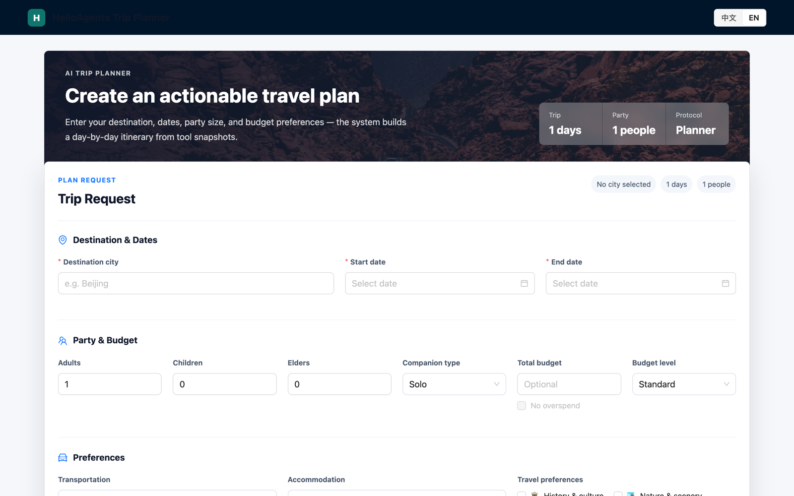
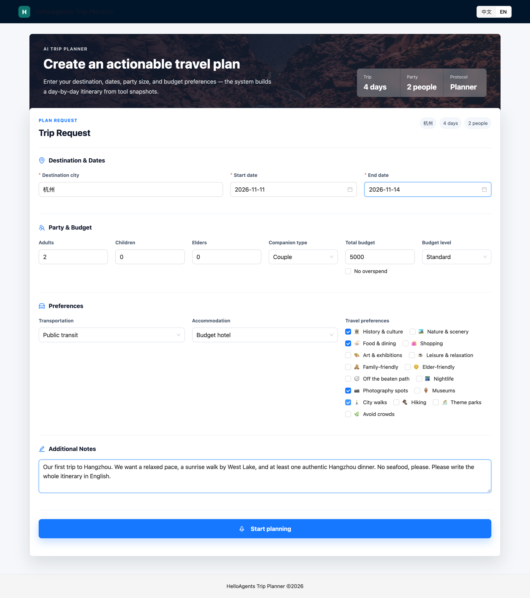
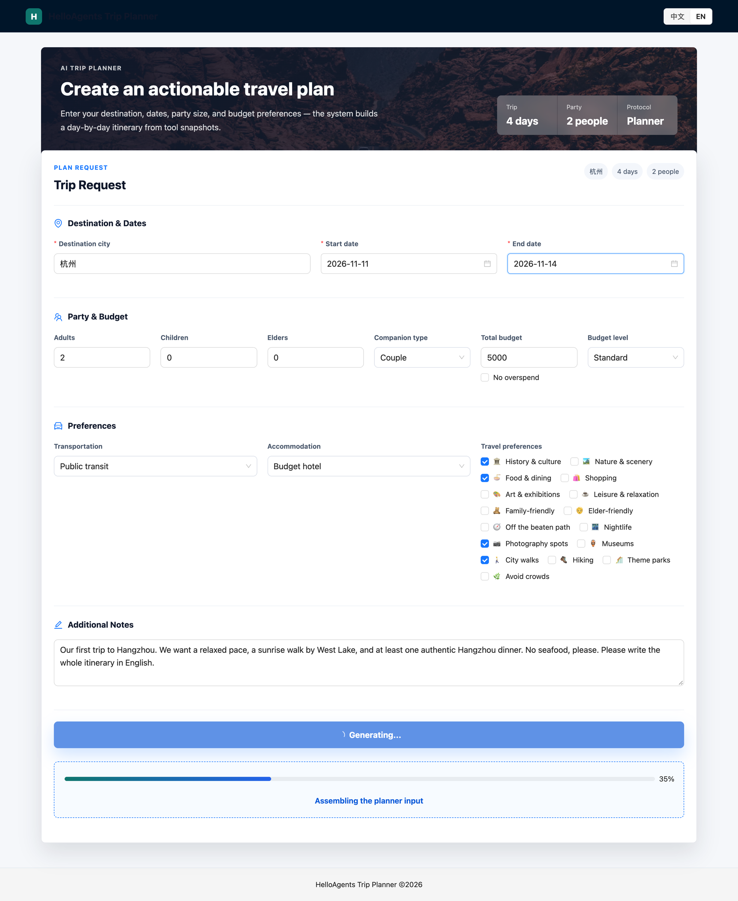
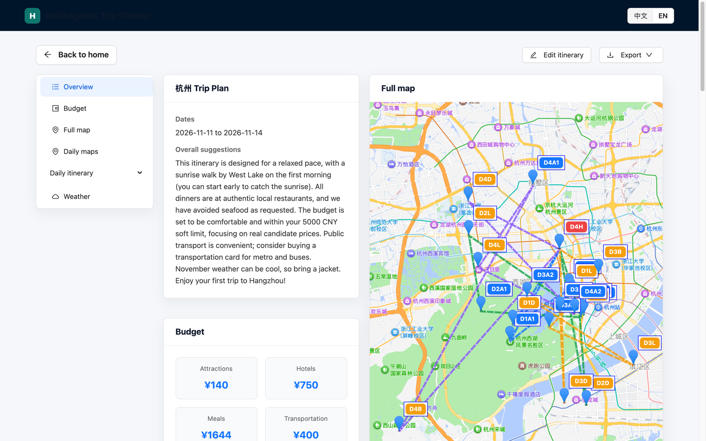
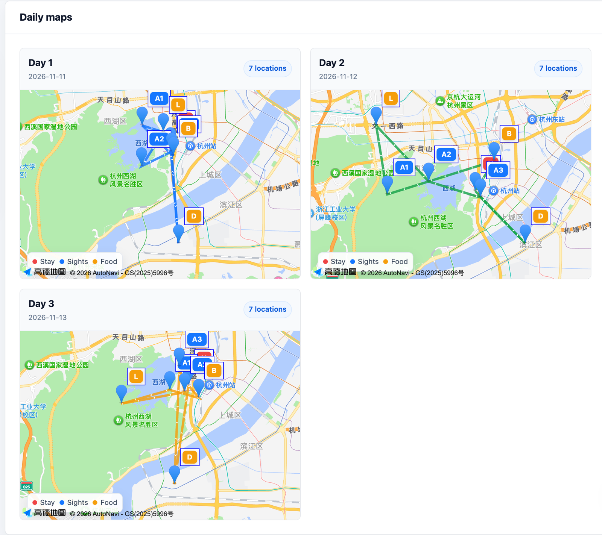
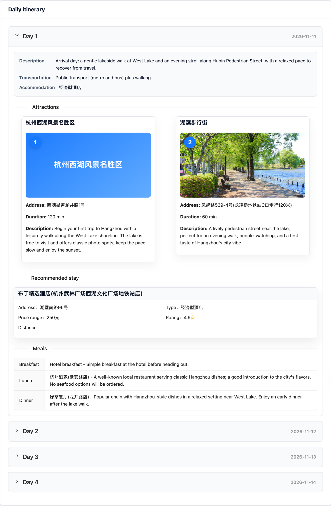
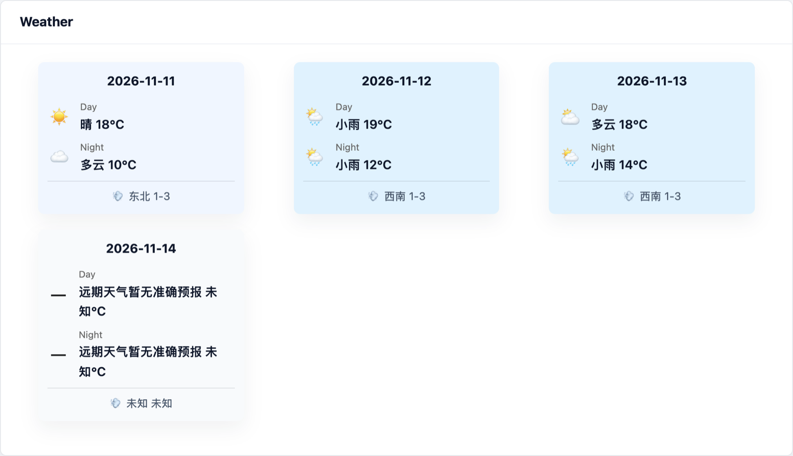

<div align="center">

# HelloAgents Trip Planner

**English** | [日本語](README.ja.md)

An AI trip planner that turns a short request into a day-by-day itinerary, with a budget, maps, hotels, meals, and weather, all grounded in real map data.

</div>

---

## Table of Contents

- [Why this project](#why-this-project)
- [Architecture](#architecture)
- [Use case: a couple plans a 4-day trip to Hangzhou](#use-case-a-couple-plans-a-4-day-trip-to-hangzhou)
- [Getting started](#getting-started)
- [Troubleshooting](#troubleshooting)
- [Project layout](#project-layout)
- [License](#license)

## Why this project

Most LLM trip planners let the model invent everything: attractions, opening hours, prices, hotels. This project does not trust the model with facts.

- **The facts come from tools.** Attractions, hotels, restaurants, and weather are fetched from the Amap (Gaode) REST API. Ticket, hotel, and meal prices come from deterministic pricing rules.
- **The model only plans.** The backend compiles everything into an auditable `PlannerContext`. A single Planner LLM then arranges those facts into a structured `TripPlan` JSON.
- **The output is checked.** Every candidate plan is parsed, validated, and scored by rules for budget fit, POI grounding, and duplicates. If the LLM fails, a deterministic fallback still gives the user a usable plan.

## Architecture

<p align="center">
  
</p>

> An interactive version (with PNG/PDF export) is in [`docs/architecture.html`](docs/architecture.html). It was generated with the [architecture-diagram](https://github.com/Cocoon-AI/architecture-diagram-generator) skill.

### Components

| Layer | Tech | Responsibility |
| --- | --- | --- |
| Frontend | Vue 3, TypeScript, Vite, Ant Design Vue, Amap JS API | Request form (`Home.vue`), plan viewer with maps (`Result.vue`), zh/en i18n |
| API | FastAPI | `POST /api/trip/plan`, `POST /api/trip/plan/stream` (SSE), map/POI/RAG helper routes |
| Planner | LangGraph state machine (`backend/app/graph/`) | Orchestrates collect → merge → generate → rerank, with retry and fallback |
| Planner core | `backend/app/planner/` | `PlannerContext`, pricing, rerank scoring, output validation, fallback plan |
| External | Amap Web Service, OpenAI-compatible LLM (e.g. `deepseek-chat`) | Ground-truth travel data; plan generation |
| Optional | Qdrant RAG, Critic loop, LangSmith | Travel-post inspiration, self-review, tracing and evaluation |

### Request lifecycle

1. **Collect (fan-out).** Three collectors call Amap in parallel for attractions, weather, and hotels. A fourth RAG collector is added when `PLANNER_ENABLE_RAG=1`.
2. **Merge context.** Results are compiled into a `PlannerContext`: candidate POIs, price hints for hotels, tickets, and meals, the budget ledger, and a compact snapshot for the prompt.
3. **Build query.** The context and user constraints become the Planner prompt.
4. **Generate (loop).** The Planner LLM produces `TripPlan` JSON, and each attempt raises the temperature for diversity. Every parse or validation failure is recorded instead of raised. If no attempt yields a candidate, the graph retries on the fallback model, then falls back to a deterministic template.
5. **Rerank.** A rule-based score picks the best candidate for budget, grounding, and duplicates. The optional **critic ⇄ revise** loop (`PLANNER_ENABLE_CRITIC=1`) can then review and repair it.
6. **Stream back.** `/plan/stream` emits one SSE progress event per graph node, then the final plan.

**Key invariant:** graph nodes never raise to abort a run. The user always gets *a* plan.

## Use case: a couple plans a 4-day trip to Hangzhou

> **Scenario.** Lena and Tom are visiting Hangzhou for four days in mid-November. They want a relaxed pace, a sunrise walk by West Lake, and an authentic local dinner. They don't eat seafood, and their budget is ¥5,000 for two.
>
> All screenshots below come from a real run of this project. Nothing was mocked.

### 1. Open the app and switch to English

Lena opens `http://localhost:5173` and uses the **中文 / EN** switch in the top-right corner to set the UI to English.

<p align="center"></p>

### 2. Describe the trip

She fills in the request form:

| Field | Value |
| --- | --- |
| Destination city | `杭州` (Hangzhou). Amap resolves Chinese city names most reliably; see [Troubleshooting](#troubleshooting). |
| Dates | 2026-11-11 → 2026-11-14 (4 days) |
| Party | 2 adults, companion type **Couple** |
| Budget | ¥5,000 total, level **Standard** |
| Transport / stay | Public transit, budget hotel |
| Preferences | History & culture, Food & dining, Photography spots, City walks |
| Notes | *"Our first trip to Hangzhou. We want a relaxed pace, a sunrise walk by West Lake, and at least one authentic Hangzhou dinner. No seafood, please. Please write the whole itinerary in English."* |

<p align="center"></p>

### 3. Watch the planner work

After she clicks **Start planning**, the progress bar follows the LangGraph nodes live over SSE: collecting data, assembling the planner input, generating, and ranking.

<p align="center"></p>

### 4. Review the overview, budget, and full map

About a minute later, the result page opens. The overview reflects every request: a sunrise walk by West Lake on the first morning, authentic local dinners, and no seafood, plus a tip to bring a jacket for November. The budget breakdown comes to **¥2,934**: attractions ¥140, hotels ¥750, meals ¥1,644, and transport ¥400. That is well under the ¥5,000 cap. The full map plots all stays, sights, and meals, with a color for each of the four days.

<p align="center"></p>

### 5. Check each day's route

Each day gets its own map, so Lena can check that the route doesn't zig-zag across the city. The four days have different themes:

| Day | Theme | Highlights |
| --- | --- | --- |
| 1 · Nov 11 | Arrival, easy lakeside walk | West Lake shoreline (西湖), Hubin Pedestrian Street (湖滨步行街) |
| 2 · Nov 12 | Culture and history | Lingyin Temple (灵隐寺), Southern Song Deshou Palace Museum (德寿宫), Qinghefang (清河坊) |
| 3 · Nov 13 | West Lake's quieter spots | Leifeng Pagoda (雷峰塔), Quyuan Fenghe (曲院风荷), Liulang Wenying (柳浪闻莺) |
| 4 · Nov 14 | Grand Canal and departure | Gongchen Bridge historic block (拱宸桥), Hangzhou Museum (杭州博物馆) |

<p align="center"></p>

### 6. Read the day-by-day itinerary

Each day lists its attractions (with address, suggested duration, and tickets), a recommended hotel, and breakfast, lunch, and dinner. Every place is a real Amap POI. Day 1, for example, pairs a slow walk along West Lake with lunch at Hangzhou Restaurant (杭州酒家), a classic local spot. Names and addresses keep their original Chinese so they can be searched on any map app.

<p align="center"></p>

### 7. Check the weather, then edit or export

Amap forecasts only about four days ahead, so Days 1–3 show a real forecast: sunny on Day 1, light rain on Day 2, cloudy on Day 3. Day 4 falls just outside that window and shows "no forecast yet". The plan still covers it, and the forecast fills in if Lena regenerates closer to the date. From here Lena can use **Edit itinerary** to adjust anything, or **Export** the plan to share with Tom.

<p align="center"></p>

## Getting started

### Prerequisites

- Python **3.11+** and Node.js **22**
- An **Amap (Gaode)** Web Service key (backend) and a Web JS API key (frontend maps): <https://lbs.amap.com/>
- An **OpenAI-compatible** LLM endpoint using a *non-reasoning* chat model, e.g. `deepseek-chat`
- Optional: Unsplash key (attraction photos), Docker (local Qdrant for RAG), LangSmith key (tracing)

### 1. Backend

```bash
cd backend
python -m venv .venv && source .venv/bin/activate
pip install -r requirements.txt
cp .env.example .env
```

Set at least these values in `backend/.env`:

```bash
AMAP_API_KEY=your_amap_web_service_key
LLM_PROVIDER=openai
LLM_MODEL_ID=deepseek-chat
LLM_API_KEY=your_llm_api_key
LLM_BASE_URL=https://api.deepseek.com
PORT=7000
```

Start it:

```bash
python run.py
```

- API: `http://localhost:7000`
- Swagger UI: `http://localhost:7000/docs`
- Health check: `http://localhost:7000/health`

> **macOS note:** the AirPlay Receiver often occupies port 7000. If so, set `PORT=8000` and update the proxy target in `frontend/vite.config.ts` to match.

### 2. Frontend

```bash
cd frontend
npm ci
cp .env.example .env
```

Set the following in `frontend/.env`:

```bash
VITE_API_BASE_URL=            # leave empty to use the Vite /api proxy in dev
VITE_AMAP_WEB_KEY=your_amap_web_key
VITE_AMAP_WEB_JS_KEY=your_amap_web_js_key
```

Start the dev server:

```bash
npm run dev -- --host 0.0.0.0 --port 5173
```

Open <http://localhost:5173>.

### 3. Optional modules

| Module | Enable with | Notes |
| --- | --- | --- |
| RAG travel notes | `PLANNER_ENABLE_RAG=1` + `QDRANT_URL`, `MODELSCOPE_API_KEY` | `docker compose up -d` starts a local Qdrant. Import data with `backend/scripts/rag_import.py`. Notes are soft inspiration only. |
| Critic reflection loop | `PLANNER_ENABLE_CRITIC=1`, `PLANNER_MAX_REVISE=2` | Deterministic checks first, then a gated LLM review |
| LangSmith tracing / eval | `LANGSMITH_TRACING=true` + `LANGSMITH_API_KEY` | See [`eval/`](eval/) for the experiment runner |

### 4. Tests

```bash
cd backend
pytest                       # full suite, runs offline with injected fakes
UPDATE_GOLDEN=1 pytest       # regenerate golden baselines after intentional pricing/scoring changes
cd ../frontend && npm run build   # type-check + production build
```

## Troubleshooting

| Symptom | Cause | Fix |
| --- | --- | --- |
| Every request returns the generic fallback plan; logs show `EmptyLLMResponseError` | `LLM_MODEL_ID` is a reasoning model. It spends `max_tokens` on `reasoning_content` and leaves `content` empty. | Use a non-reasoning chat model, e.g. `deepseek-chat` |
| 401 errors from the planner LLM after enabling RAG | `HelloAgentsLLM` auto-detects `MODELSCOPE_API_KEY` and switches provider | Pin `LLM_PROVIDER=openai` |
| Hotels or restaurants from the wrong city | Romanized city names (e.g. `Hangzhou`) are matched loosely by Amap | Enter the city in Chinese, e.g. `杭州` |
| Weather shows "no accurate forecast" | Amap forecasts only cover the next ~4 days | Expected for trips further out; the plan still generates |
| Itinerary text is in Chinese | The Planner LLM follows the context language by default | Add "Please write the itinerary in English" to the notes |

## Project layout

```text
backend/        FastAPI app, LangGraph planner (app/graph), planner core (app/planner), RAG, services
frontend/       Vue 3 + Vite web app
training/       SFT / DPO data, frozen eval sets, rule metrics, post-training docs
eval/           LangSmith experiment runner and LLM-as-judge evaluators
scripts/        Offline generators (RAG seed corpus, human-eval plans) → out/
docs/           Architecture diagram, Dify reference workflows, README images
```

See [PROJECT_STRUCTURE.md](PROJECT_STRUCTURE.md) for the full directory map.

## License

CC BY-NC-SA 4.0

## Acknowledgements

- [HelloAgents](https://github.com/datawhalechina/Hello-Agents)
- [Amap (Gaode) Open Platform](https://lbs.amap.com/)
- [architecture-diagram-generator](https://github.com/Cocoon-AI/architecture-diagram-generator) by Cocoon AI
